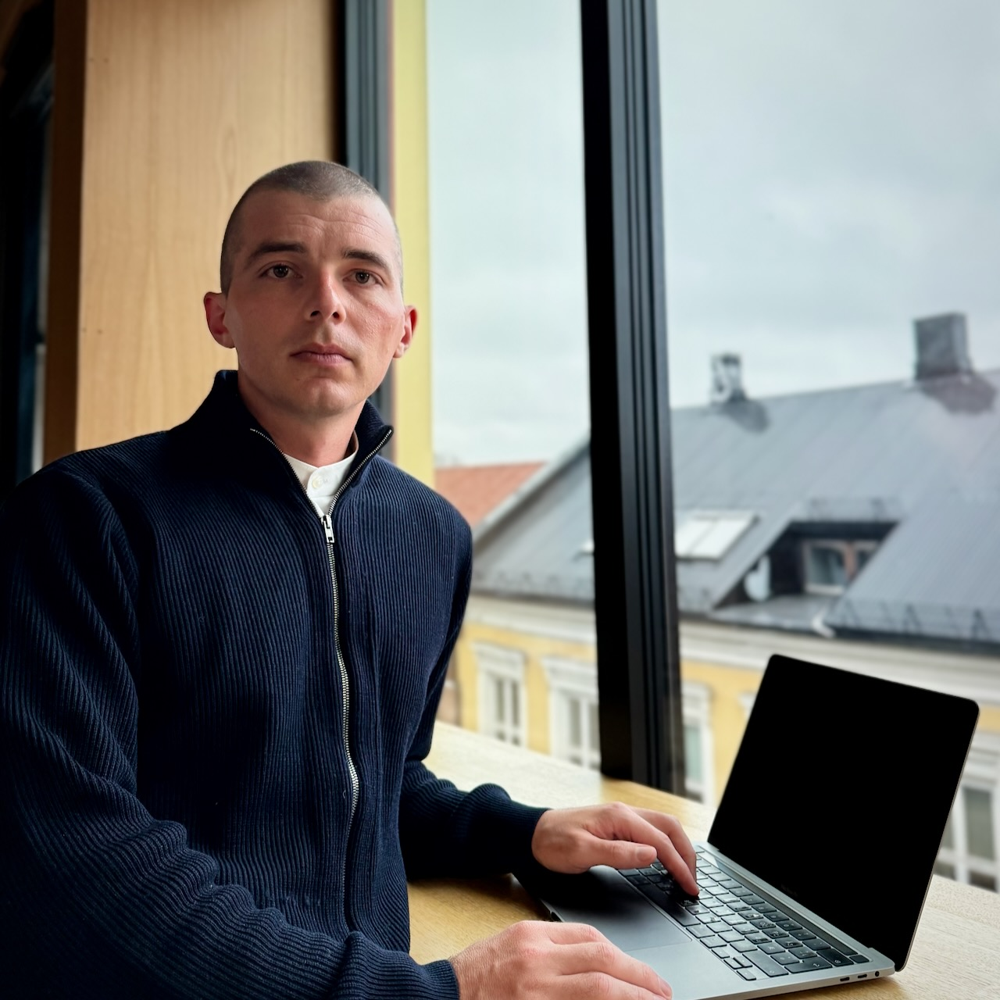

Applied Statistician · Researcher

# Richard Aubrey White

Ph.D. in Biostatistics, Harvard University

Richard leads the Norwegian Syndromic Surveillance System ([NorSySS](https://www.github.com/norsyss)) at the Norwegian Institute of Public Health, developing real-time systems to monitor population health and detect outbreaks across Norway's five million residents.

His work focuses on syndromic surveillance, signal-detection algorithms, and the design of real-time reporting systems for public-health operations. Combining statistical modeling with operational epidemiology, he builds the infrastructure that supports health authorities nationwide.

From 2015 to 2022 he was statistical lead for the Norwegian Mortality Monitoring System (NorMOMO), running weekly all-cause mortality analyses for Norway and [contributing](https://github.com/EuroMOMOnetwork/MOMO/blob/dbb3632827e037fb469223fec3fa2aa079d5d0b6/DESCRIPTION#L6) to the European monitoring system for total mortality ([EuroMOMO](https://www.euromomo.eu)).

## Scientific Production

[101](publications.llms.md)

Publications

[70,110](https://scholar.google.com/citations?user=75oKEWoAAAAJ&hl=en&oi=ao)

Citations

[47](https://scholar.google.com/citations?user=75oKEWoAAAAJ&hl=en&oi=ao)

h-index

[12](#rpackages)

R packages on CRAN

## Selected Experience

Researcher / Project Manager

Norwegian Institute of Public Health

2023–NOW · REMOTE

Leads Norway's national syndromic surveillance; sets statistical methodology and alerts health authorities to outbreaks in real time.

Health Officer

Norwegian Red Cross (IFRC)

2022 · COLOMBO, SRI LANKA

Head statistician for a 3,100-household nationwide needs assessment during the country's humanitarian emergency.

Community-Based Surveillance Delegate

Norwegian Red Cross (IFRC)

2019 · BEIRA, MOZAMBIQUE

Responded to the cholera outbreak after Cyclone Idai; ran a real-time surveillance system across Red Cross oral-rehydration points.

Statistician

Palestinian National Institute of Public Health

2017–2019 · RAMALLAH, PALESTINE

Trained local staff in data management and statistical programming for the national maternal- and child-health registry.

GIS Expert / Data Manager

World Health Organization

2015 · KAMBIA, SIERRA LEONE

Responded to the Ebola epidemic — built and ran a real-time surveillance system linking treatment centers, care centers and burials.

Biostatistician

World Health Organization

2011 · GENEVA, SWITZERLAND

Produced Global Burden of Disease (GBD 2010) prevalence estimates — vision loss, micronutrient deficiency and stunting — across all UN member states.

## Flagship Projects

NorSySS

Project Manager · 2023–now

[Norway's national syndromic surveillance system](https://www.github.com/norsyss) — 100+ syndromes from GP and out-of-hours consultations, with 1,000,000+ automated analyses daily across every municipality.

Core Surveillance 9 (cs9)

Lead Developer · 2014–now

[Open-source R framework](https://niphr.github.io/cs9) for building real-time surveillance systems — scheduled analysis, automated reporting and alerting, reproducible by design. The backbone of NorSySS and Sykdomspulsen.

Sykdomspulsen

Technical Lead · 2019–2023

[Award-winning](post/2021-11-18-poster-prize-for-sykdomspulsen/) national platform built with an 8-person team; 1,000+ daily reports spanning mortality ([EuroMOMO](https://euromomo.eu)), COVID-19 and 80+ infectious-disease syndromes.

R packages — CRAN

[attrib](https://niphr.github.io/attrib/)[cohort](https://www.rwhite.no/cohort/)[csalert](https://niphr.github.io/csalert/)[csdata](https://niphr.github.io/csdata/)[csdb](https://niphr.github.io/csdb/)[csmaps](https://niphr.github.io/csmaps/)[csstyle](https://niphr.github.io/csstyle/)[cstidy](https://niphr.github.io/cstidy/)[cstime](https://niphr.github.io/cstime/)[csutil](https://niphr.github.io/csutil/)[org](https://www.rwhite.no/org/)[plnr](https://www.rwhite.no/plnr/)

R packages — GitHub

[cs9](https://niphr.github.io/cs9)[MOMO](https://github.com/EuroMOMOnetwork/MOMO/)

## Key Publications

2026

Excess all-cause mortality in Norway in 2024

White et al. · *Scandinavian Journal of Public Health* [\[ DOI \]](https://doi.org/10.1177/14034948251371830) [\[ PDF \]](https://www.rwhite.no/articles/2026-white-mortality.pdf)

Excess primary healthcare consultations in Norway in 2024 compared to pre-COVID-19-pandemic baseline trends

White et al. · *Archives of Public Health* [\[ DOI \]](https://doi.org/10.1186/s13690-025-01817-8) [\[ PDF \]](https://www.rwhite.no/articles/2026-white-consultations.pdf)

2024

Aberrations in medically certified sick leave and primary healthcare consultations in Norway in 2023 compared to pre-COVID-19-pandemic trends

White et al. · *Archives of Public Health* [\[ DOI \]](https://doi.org/10.1186/s13690-024-01411-4) [\[ PDF \]](https://www.rwhite.no/articles/2024-white.pdf)

[View all 101 publications →](publications.llms.md)

## Education

Harvard University\
[Ph.D.](articles/2012-white.pdf) in Biostatistics *· 2011–2012*\
M.A. in Biostatistics *· 2009–2011, Frank Knox Fellowship*

University of Wollongong\
B. Adv. Mathematics *· 2005–2009, First Class Honours*

University of Bergen\
Nordic languages & literature *· 2022–2023, one-year program*

## Technical Skills & Languages

**Programming & Analysis**R (20+ yrs) · STATA (15+ yrs) · Python**Infrastructure & DevOps**Docker (10+ yrs) · CI/CD (10+ yrs) · Kubernetes

**Languages**English (Fluent) · Norwegian (B2)

## Professional Experience

### Norwegian Institute of Public Health

02.2023 – now\
Remote

Researcher / Project Manager — NorSySS

- Project manager for [NorSySS](https://www.github.com/norsyss/), surveilling infectious diseases from general-practitioner and out-of-hours primary-care consultations.
- Complex statistical analyses run automatically for every location in Norway, producing reports and alerting stakeholders.
- Organized the 2023 [Northern European Symposium on Automated Surveillance](presentations/2023-12-core-surveillance-9-as-a-framework-for-real-time-analysis-and-disease-surveillance.pdf).

R · Kubernetes · Docker/Podman · CI/CD · Apache Airflow · [cs9](https://niphr.github.io/cs9)

07.2019 – 01.2023\
Remote

Researcher / Technical Lead — Sykdomspulsen

- Technical lead for the [award-winning](post/2021-11-18-poster-prize-for-sykdomspulsen/) Sykdomspulsen platform (8-person team), a real-time analysis and surveillance system.
- Owned training, mentoring, supervision and quality assurance of statistical methods and code.
- Surveillance areas: all-cause / cause-specific / attributable mortality (part of [EuroMOMO](https://euromomo.eu)), COVID-19, influenza, tuberculosis, IPD, meningococcal disease, pertussis, antibiotic use, and 80+ syndromes via NorSySS.
- 1,000,000+ analyses per day; 1,000+ automatic reports per day (PDF / Excel / email / SMS).

R · Kubernetes · Docker/Podman · CI/CD · Apache Airflow · [cs9](https://niphr.github.io/cs9)

06.2014 – 06.2019\
Remote

Researcher — Infectious Disease Epidemiology

- Advised outbreak teams and researchers in statistical concepts, methods and programming.
- Statistical supervision of five [EPIET](https://www.ecdc.europa.eu/en/epiet-euphem) fellows and nine Ph.D. students.
- [Modeled](articles/2015-white-ebola.pdf) the 2014 Ebola outbreak's likelihood of reaching Norway and the effectiveness of entry screening; [modeled](articles/2017-meijerink.pdf) HCV burden in Norwegian people who inject drugs.
- Head statistician for the data monitoring committees (DMCs) of the PEEP (Haydom, Tanzania) and Safer Births Moyo (Muhimbili, Tanzania) randomized trials.

01.2012 – 05.2014\
Oslo, Norway

Postdoctoral Researcher — Genes & Environment

- Built database structures integrating questionnaires, lab toxicant concentrations and Illumina microbial data into analysis datasets.
- [Investigated](articles/2015-white-suicide.pdf) the relationship between seasonality, sunlight and suicide; and between [gun ownership and completed suicide](articles/2013-miller.pdf) in the US.

### Consortium for Statistics in Disease Surveillance (CSIDS)

01.2023 – 12.2025\
Remote

Chairperson

- Oversaw the collaboration between statisticians, epidemiologists and researchers developing the open-source [R packages](https://www.github.com/niphr) used for disease surveillance.

### Norwegian Red Cross

04.2024 – 05.2024\
Remote

Head Statistician (IFRC)

- Head statistician for an 1,800-household nationwide needs assessment responding to the complex humanitarian emergency in Sri Lanka; developed the protocol and analyzed most of the data.

08.2022 – 09.2022\
Colombo, Sri Lanka

Health Officer (IFRC)

- Head statistician for a 3,100-household nationwide [needs assessment](articles/2022-wickremesekera.pdf) ([annex](articles/2022-wickremesekera-annex.pdf)) during Sri Lanka's humanitarian emergency; developed the protocol and health-sector questions and analyzed most of the data.

04.2019 – 05.2019\
Beira, Mozambique

Community-Based Surveillance Delegate (IFRC)

- Responded to the cholera outbreak caused by Cyclone Idai; ran a [real-time surveillance system](resources/mozambique.webm) for people with diarrhea visiting Red Cross oral-rehydration points and liaised with the Ministry of Health.

### Norwegian Scientific Committee for Food and Environment (VKM)

01.2026 – now\
Remote

External Expert — Next-Generation Risk Assessment

- Implementing the statistical protocol to evaluate INVITES-IN, a tool for assessing the internal validity of in-vitro studies.

2023\
Remote

External Expert — Next-Generation Risk Assessment

- Developed the [statistical protocol](articles/2023-mathisen.pdf) to evaluate INVITES-IN, a tool for assessing the internal validity of in-vitro studies.

### Palestinian National Institute of Public Health (PNIPH)

09.2017 – 09.2019\
Ramallah, Palestine

Statistician

- Trained local staff in data management and statistical programming for the national maternal- and child-health [registry](articles/2021-isbeih.pdf) over a two-year posting.
- Validated indicators from the newly formed national healthcare-worker registry.

### World Health Organization (WHO)

01.2015 – 02.2015\
Kambia, Sierra Leone

GIS Expert / Data Manager — GOARN

- Responded to the West-African Ebola epidemic; built and ran a real-time surveillance system linking the national emergency number, holding centers, community care centers, treatment centers and burials.
- Geocoded and mapped outbreak data; produced daily situation reports; trained and supervised national and international staff.

04.2011 – 11.2011\
Geneva, Switzerland

Biostatistician — Mortality & Burden of Disease

- Collected [cause-of-death](articles/2015-mathers.pdf) data from national registries and calculated avoidable-mortality estimates across high-income and developing countries.
- Produced Global Burden of Disease (GBD 2010) prevalence estimates — [vision loss](articles/2013-stevens.pdf), [micronutrient deficiency](articles/2015-stevens.pdf) and [stunting](articles/2012-stevens.pdf) — for all UN member states.

06.2010 – 11.2010\
Remote

Biostatistician — Stop TB Department

- Managed, cleaned and analyzed MDR-TB datasets from South Africa, Uzbekistan, Bangladesh and Peru.
- Provided [recommendations](articles/2016-mitnick.pdf) for the WHO Guidelines for the Programmatic Management of Drug-Resistant Tuberculosis (3rd ed.) via multi-cohort survival analyses.

<hello@rwhite.no>

[GitHub](https://github.com/raubreywhite)[X](https://x.com/raubreywhite)[LinkedIn](https://no.linkedin.com/in/richard-white4)
