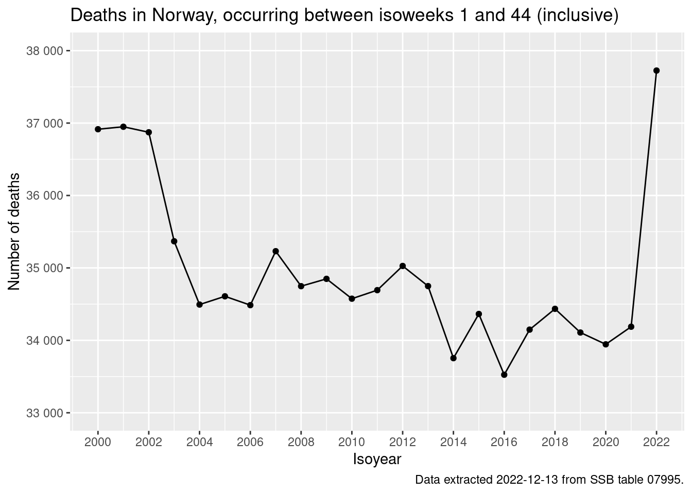
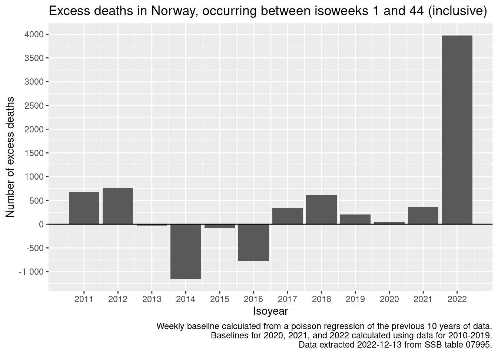

# All-Cause Mortality in Norway

Examining all-cause mortality in Norway using publically available mortality data from SSB.

Author

[Richard Aubrey White](https://www.rwhite.no) [![](data:image/png;base64,iVBORw0KGgoAAAANSUhEUgAAABAAAAAQCAYAAAAf8/9hAAAAGXRFWHRTb2Z0d2FyZQBBZG9iZSBJbWFnZVJlYWR5ccllPAAAA2ZpVFh0WE1MOmNvbS5hZG9iZS54bXAAAAAAADw/eHBhY2tldCBiZWdpbj0i77u/IiBpZD0iVzVNME1wQ2VoaUh6cmVTek5UY3prYzlkIj8+IDx4OnhtcG1ldGEgeG1sbnM6eD0iYWRvYmU6bnM6bWV0YS8iIHg6eG1wdGs9IkFkb2JlIFhNUCBDb3JlIDUuMC1jMDYwIDYxLjEzNDc3NywgMjAxMC8wMi8xMi0xNzozMjowMCAgICAgICAgIj4gPHJkZjpSREYgeG1sbnM6cmRmPSJodHRwOi8vd3d3LnczLm9yZy8xOTk5LzAyLzIyLXJkZi1zeW50YXgtbnMjIj4gPHJkZjpEZXNjcmlwdGlvbiByZGY6YWJvdXQ9IiIgeG1sbnM6eG1wTU09Imh0dHA6Ly9ucy5hZG9iZS5jb20veGFwLzEuMC9tbS8iIHhtbG5zOnN0UmVmPSJodHRwOi8vbnMuYWRvYmUuY29tL3hhcC8xLjAvc1R5cGUvUmVzb3VyY2VSZWYjIiB4bWxuczp4bXA9Imh0dHA6Ly9ucy5hZG9iZS5jb20veGFwLzEuMC8iIHhtcE1NOk9yaWdpbmFsRG9jdW1lbnRJRD0ieG1wLmRpZDo1N0NEMjA4MDI1MjA2ODExOTk0QzkzNTEzRjZEQTg1NyIgeG1wTU06RG9jdW1lbnRJRD0ieG1wLmRpZDozM0NDOEJGNEZGNTcxMUUxODdBOEVCODg2RjdCQ0QwOSIgeG1wTU06SW5zdGFuY2VJRD0ieG1wLmlpZDozM0NDOEJGM0ZGNTcxMUUxODdBOEVCODg2RjdCQ0QwOSIgeG1wOkNyZWF0b3JUb29sPSJBZG9iZSBQaG90b3Nob3AgQ1M1IE1hY2ludG9zaCI+IDx4bXBNTTpEZXJpdmVkRnJvbSBzdFJlZjppbnN0YW5jZUlEPSJ4bXAuaWlkOkZDN0YxMTc0MDcyMDY4MTE5NUZFRDc5MUM2MUUwNEREIiBzdFJlZjpkb2N1bWVudElEPSJ4bXAuZGlkOjU3Q0QyMDgwMjUyMDY4MTE5OTRDOTM1MTNGNkRBODU3Ii8+IDwvcmRmOkRlc2NyaXB0aW9uPiA8L3JkZjpSREY+IDwveDp4bXBtZXRhPiA8P3hwYWNrZXQgZW5kPSJyIj8+84NovQAAAR1JREFUeNpiZEADy85ZJgCpeCB2QJM6AMQLo4yOL0AWZETSqACk1gOxAQN+cAGIA4EGPQBxmJA0nwdpjjQ8xqArmczw5tMHXAaALDgP1QMxAGqzAAPxQACqh4ER6uf5MBlkm0X4EGayMfMw/Pr7Bd2gRBZogMFBrv01hisv5jLsv9nLAPIOMnjy8RDDyYctyAbFM2EJbRQw+aAWw/LzVgx7b+cwCHKqMhjJFCBLOzAR6+lXX84xnHjYyqAo5IUizkRCwIENQQckGSDGY4TVgAPEaraQr2a4/24bSuoExcJCfAEJihXkWDj3ZAKy9EJGaEo8T0QSxkjSwORsCAuDQCD+QILmD1A9kECEZgxDaEZhICIzGcIyEyOl2RkgwAAhkmC+eAm0TAAAAABJRU5ErkJggg==)](https://orcid.org/0000-0002-6747-1726)

Published

December 13, 2022

``` r
library(data.table)
library(magrittr)
library(ggplot2)

if (interactive()) {
  folder_location <- "post/2022-12-13-all-cause-mortality-in-norway/"
} else {
  folder_location <- ""
}
```

``` r
# Downloading data
data <- PxWebApiData::ApiData(
  "https://data.ssb.no/api/v0/en/table/07995",
  Kjonn = "0",
  Alder = "999A",
  Tid = as.character(2000:2022),
  Uke = paste0("U", formatC(1:52, width = 2, flag = "0"))
)

# Cleaning
d_deaths <- data$dataset[, c("Uke", "Tid", "value")]
setDT(d_deaths)
setnames(d_deaths, c("week", "isoyear", "deaths_n"))
d_deaths[, isoweek := stringr::str_remove(week, "U")]
d_deaths[, isoyearweek := paste0(isoyear, "-", isoweek)]
d_deaths[, isoweek := as.numeric(isoweek)]
d_deaths[, isoyear := as.numeric(isoyear)]
d_deaths[, week := NULL]
setcolorder(d_deaths, c("isoyear", "isoweek", "isoyearweek", "deaths_n"))

# Removing the latest 3 weeks of data (due to registration delay)
max_isoweek <- d_deaths[isoyear == 2022 & !is.na(deaths_n)]$isoweek %>%
  max() - 3
d_deaths <- d_deaths[isoweek <= max_isoweek]
```

``` r
# Aggregating
pd <- d_deaths[, .(deaths_n = sum(deaths_n)), keyby = .(isoyear)]

# Plotting
q <- ggplot(pd, aes(x = isoyear, y = deaths_n))
q <- q + geom_line()
q <- q + geom_point()
q <- q + scale_x_continuous(
  "Isoyear",
  breaks = seq(2000, 2022, 2)
  )
q <- q + scale_y_continuous(
  "Number of deaths",
  labels = csstyle::format_num_as_nor_num_0,
  breaks = seq(33000, 38000, 1000)
)
q <- q + expand_limits(y = c(33000, 38000))
q <- q + labs(
    title = glue::glue(
      "Deaths in Norway, occurring between isoweeks 1 and {max_isoweek} (inclusive)"
    )
  )
q <- q + labs(caption = "Data extracted 2022-12-13 from SSB table 07995.")
q
```



``` r
# Estimating the baseline
setorder(d_deaths, isoyearweek)
for(isoyear_pred in 2011:2022) for(isoweek_model in unique(d_deaths$isoweek)){

  # Determining the training data
  if(isoyear_pred <= 2019){
    isoyear_train <- (isoyear_pred-10):(isoyear_pred-1)
  } else {
    isoyear_train <- 2010:2019
  }
  
  # Fitting the model
  fit <- glm(
    deaths_n ~ isoyear, 
    data = d_deaths[isoweek %in% isoweek_model & isoyear %in% isoyear_train],
    family = "poisson"
  )
  
  # Predicting the baseline
  pred <- predict(
      fit, 
      d_deaths[isoweek %in% isoweek_model & isoyear %in% isoyear_pred]
    ) %>% 
    exp()
  d_deaths[
    isoweek %in% isoweek_model & isoyear %in% isoyear_pred, 
    deaths_baseline_n := pred
  ]
}
```

``` r
# Calculating the excess mortality
d_deaths[, deaths_excess_n := deaths_n - deaths_baseline_n]
```

``` r
# Aggregating
pd <- d_deaths[
  !is.na(deaths_excess_n),
  .(deaths_excess_n = sum(deaths_excess_n)), 
  keyby = .(isoyear)
]

# Plotting
q <- ggplot(pd, aes(x = isoyear, y = deaths_excess_n))
q <- q + geom_col()
q <- q + geom_hline(yintercept = 0, color = "black")
q <- q + scale_x_continuous(
  "Isoyear",
  breaks = seq(2011, 2022, 1)
  )
q <- q + scale_y_continuous(
  "Number of excess deaths",
  labels = csstyle::format_num_as_nor_num_0,
  breaks = seq(-1000, 4000, 500)
)
q <- q + labs(
    title = glue::glue(
      "Excess deaths in Norway, occurring between isoweeks 1 and {max_isoweek} (inclusive)"
    )
  )
q <- q + labs(
  caption = "Weekly baseline calculated from a poisson regression of the previous 10 years of data.\nBaselines for 2020, 2021, and 2022 calculated using data for 2010-2019.\nData extracted 2022-12-13 from SSB table 07995."
)
q
```


