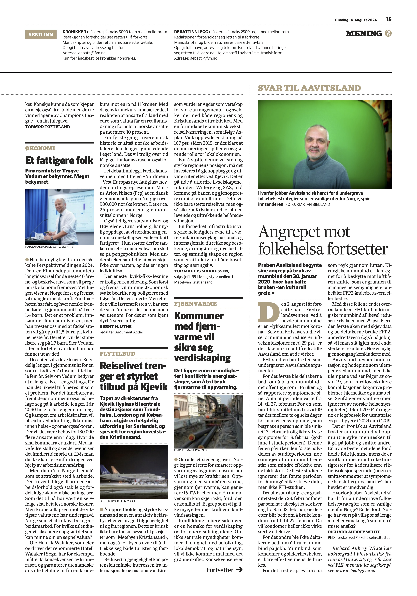

# The attack on public health continues

*Op-ed • Fædrelandsvennen*

Fædrelandsvennen

Op-ed

Preben Aavitsland began his attacks on the use of face masks on January 30, 2020, where he called the use “a cultural thing.”

Author

[Richard Aubrey White](https://www.rwhite.no) [![](data:image/png;base64,iVBORw0KGgoAAAANSUhEUgAAABAAAAAQCAYAAAAf8/9hAAAAGXRFWHRTb2Z0d2FyZQBBZG9iZSBJbWFnZVJlYWR5ccllPAAAA2ZpVFh0WE1MOmNvbS5hZG9iZS54bXAAAAAAADw/eHBhY2tldCBiZWdpbj0i77u/IiBpZD0iVzVNME1wQ2VoaUh6cmVTek5UY3prYzlkIj8+IDx4OnhtcG1ldGEgeG1sbnM6eD0iYWRvYmU6bnM6bWV0YS8iIHg6eG1wdGs9IkFkb2JlIFhNUCBDb3JlIDUuMC1jMDYwIDYxLjEzNDc3NywgMjAxMC8wMi8xMi0xNzozMjowMCAgICAgICAgIj4gPHJkZjpSREYgeG1sbnM6cmRmPSJodHRwOi8vd3d3LnczLm9yZy8xOTk5LzAyLzIyLXJkZi1zeW50YXgtbnMjIj4gPHJkZjpEZXNjcmlwdGlvbiByZGY6YWJvdXQ9IiIgeG1sbnM6eG1wTU09Imh0dHA6Ly9ucy5hZG9iZS5jb20veGFwLzEuMC9tbS8iIHhtbG5zOnN0UmVmPSJodHRwOi8vbnMuYWRvYmUuY29tL3hhcC8xLjAvc1R5cGUvUmVzb3VyY2VSZWYjIiB4bWxuczp4bXA9Imh0dHA6Ly9ucy5hZG9iZS5jb20veGFwLzEuMC8iIHhtcE1NOk9yaWdpbmFsRG9jdW1lbnRJRD0ieG1wLmRpZDo1N0NEMjA4MDI1MjA2ODExOTk0QzkzNTEzRjZEQTg1NyIgeG1wTU06RG9jdW1lbnRJRD0ieG1wLmRpZDozM0NDOEJGNEZGNTcxMUUxODdBOEVCODg2RjdCQ0QwOSIgeG1wTU06SW5zdGFuY2VJRD0ieG1wLmlpZDozM0NDOEJGM0ZGNTcxMUUxODdBOEVCODg2RjdCQ0QwOSIgeG1wOkNyZWF0b3JUb29sPSJBZG9iZSBQaG90b3Nob3AgQ1M1IE1hY2ludG9zaCI+IDx4bXBNTTpEZXJpdmVkRnJvbSBzdFJlZjppbnN0YW5jZUlEPSJ4bXAuaWlkOkZDN0YxMTc0MDcyMDY4MTE5NUZFRDc5MUM2MUUwNEREIiBzdFJlZjpkb2N1bWVudElEPSJ4bXAuZGlkOjU3Q0QyMDgwMjUyMDY4MTE5OTRDOTM1MTNGNkRBODU3Ii8+IDwvcmRmOkRlc2NyaXB0aW9uPiA8L3JkZjpSREY+IDwveDp4bXBtZXRhPiA8P3hwYWNrZXQgZW5kPSJyIj8+84NovQAAAR1JREFUeNpiZEADy85ZJgCpeCB2QJM6AMQLo4yOL0AWZETSqACk1gOxAQN+cAGIA4EGPQBxmJA0nwdpjjQ8xqArmczw5tMHXAaALDgP1QMxAGqzAAPxQACqh4ER6uf5MBlkm0X4EGayMfMw/Pr7Bd2gRBZogMFBrv01hisv5jLsv9nLAPIOMnjy8RDDyYctyAbFM2EJbRQw+aAWw/LzVgx7b+cwCHKqMhjJFCBLOzAR6+lXX84xnHjYyqAo5IUizkRCwIENQQckGSDGY4TVgAPEaraQr2a4/24bSuoExcJCfAEJihXkWDj3ZAKy9EJGaEo8T0QSxkjSwORsCAuDQCD+QILmD1A9kECEZgxDaEZhICIzGcIyEyOl2RkgwAAhkmC+eAm0TAAAAABJRU5ErkJggg==)](https://orcid.org/0000-0002-6747-1726)

Published

August 13, 2024

*This is a translation of the original Norwegian op-ed, and discrepancies may exist.*

Published in Fædrelandsvennen on August 13, 2024.

*Richard Aubrey White has a PhD in biostatistics from Harvard University and is a researcher at FHI, but does not speak on behalf of his employer.*

Preben Aavitsland began his attacks on the use of face masks on January 30, 2020, where he called the use “a cultural thing.” On August 2 this year, he continued in Fædrelandsvennen, by claiming that face masks are a “[lucky charm against corona](https://www.fvn.no/mening/ukeslutt/i/wgr4X1/en-lykkeamulett-mot-korona).” Even though [FHI’s new study](https://www.bmj.com/content/386/bmj-2023-078918) shows that face masks reduce respiratory infections by 29 percent, it is not enough to satisfy Aavitsland that they work.

The FHI study has three flaws that undermine Aavitsland’s arguments.

First, participants were asked to use face masks in public spaces for two weeks, and then report their symptoms. Assume that the period lasted from February 14 to 27: For someone who has been infected with COVID-19, it takes between [two and six days](https://assets.publishing.service.gov.uk/media/641c7a9b32a8e0000cfa9327/COVID-19-infectiousness-_asymptomatic-transmission.pdf) before they show symptoms, which means that a person who was infected on February 13 probably won’t show symptoms until February 18 (well into the study period). This error affects the first half of the study period, making face masks appear less effective than they actually are. Most studies ignore the first period to avoid such biased data, but not the FHI study.

It’s like performing a pregnancy test on February 28 for a couple who has unprotected sex every day from February 8 to 13, and then is asked to use condoms from February 14 to 27. Then condoms won’t appear particularly effective either.

Second, participants were not asked to use face masks at work. Face masks, like condoms and seat belts, are only effective while being used.

Third, [corona spreads like smoke through the air](https://www.betterhealth.vic.gov.au/covid-19/improving-ventilation-stop-spread-covid-19?utm_source=social&utm_medium=facebookinstagram&utm_campaign=COVID&utm_content=Ventilation). Surgical masks are not suitable for protecting against airborne transmission, which is why many health authorities [recommend FFP2 respirators or better](https://www.betterhealth.vic.gov.au/covid-19/face-masks-covid-19).

With these flaws, it is surprising that FHI found that surgical masks still reduced risk by 29 percent. Remove the first week with biased data and ask participants to use FFP2 respirators (also at work), and you will be left with even stronger results. Something a [recent review](https://journals.asm.org/doi/10.1128/cmr.00124-23) concluded.

Aavitsland mentions skin irritation and headache as the disadvantages of face masks, but not the [disadvantages](https://covidforeningen.no/Om-Long-Covid) of long-term consequences of COVID-19, such as cardiovascular complications, cognitive problems, brain fog, and fatigue. Long-term consequences are common (but [ignored by Norwegian health authorities](https://www.nrk.no/buskerud/norsk-covidforening-om-mulige-senfolger-av-korona_-_-folk-taler-a-hore-sannheten-1.16703052)); among 20-64 year-olds, doctor visits for exhaustion are [75 percent higher in 2024 than in 2019](https://www.nrk.no/buskerud/flere-unge-dode-av-sykdom_-forskere-slar-alarm-1.16926584).

It is ironic that Aavitsland fears that face masks will encourage sick people to go to work and infect others. One of the best methods for keeping people home while they are infectious is to use rapid tests to identify the correct isolation period ([some are infectious after symptoms have ended](https://www.ncbi.nlm.nih.gov/pmc/articles/PMC9981266/)), which he [in VG](https://www.vg.no/nyheter/innenriks/i/8JK78r/fhi-om-coronatesting-jeg-gidder-ikke) has claimed is unnecessary.

Why does Aavitsland work so hard to undermine public health strategies that are common outside Norway? Is it because Norway has been on the wrong track for so long that it is difficult to turn around without losing face?
