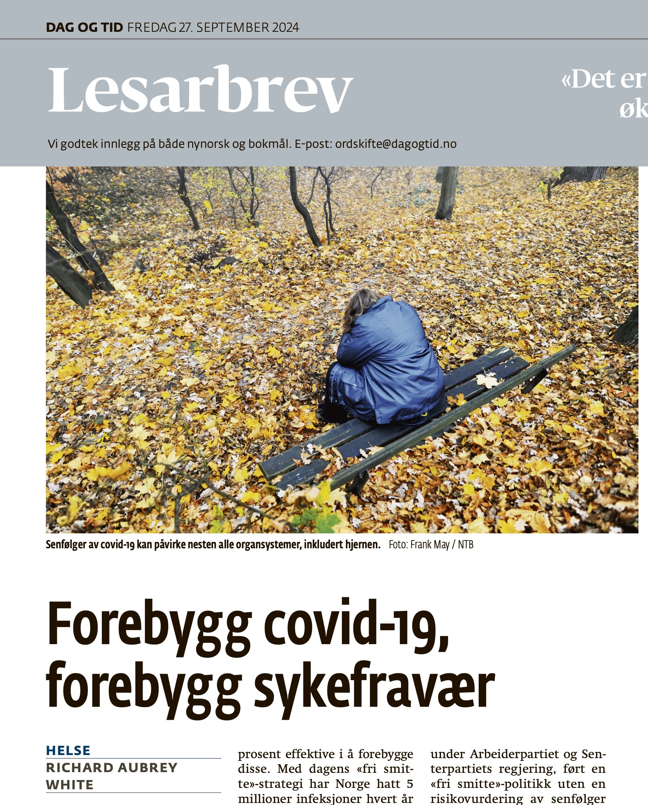

# Prevent COVID-19, prevent sick leave

*Op-ed • Dag og Tid*

Dag og Tid

Op-ed

There is good evidence that a large proportion of the increase in sick leave is due to long covid.

Author

[Richard Aubrey White](https://www.rwhite.no) [![](data:image/png;base64,iVBORw0KGgoAAAANSUhEUgAAABAAAAAQCAYAAAAf8/9hAAAAGXRFWHRTb2Z0d2FyZQBBZG9iZSBJbWFnZVJlYWR5ccllPAAAA2ZpVFh0WE1MOmNvbS5hZG9iZS54bXAAAAAAADw/eHBhY2tldCBiZWdpbj0i77u/IiBpZD0iVzVNME1wQ2VoaUh6cmVTek5UY3prYzlkIj8+IDx4OnhtcG1ldGEgeG1sbnM6eD0iYWRvYmU6bnM6bWV0YS8iIHg6eG1wdGs9IkFkb2JlIFhNUCBDb3JlIDUuMC1jMDYwIDYxLjEzNDc3NywgMjAxMC8wMi8xMi0xNzozMjowMCAgICAgICAgIj4gPHJkZjpSREYgeG1sbnM6cmRmPSJodHRwOi8vd3d3LnczLm9yZy8xOTk5LzAyLzIyLXJkZi1zeW50YXgtbnMjIj4gPHJkZjpEZXNjcmlwdGlvbiByZGY6YWJvdXQ9IiIgeG1sbnM6eG1wTU09Imh0dHA6Ly9ucy5hZG9iZS5jb20veGFwLzEuMC9tbS8iIHhtbG5zOnN0UmVmPSJodHRwOi8vbnMuYWRvYmUuY29tL3hhcC8xLjAvc1R5cGUvUmVzb3VyY2VSZWYjIiB4bWxuczp4bXA9Imh0dHA6Ly9ucy5hZG9iZS5jb20veGFwLzEuMC8iIHhtcE1NOk9yaWdpbmFsRG9jdW1lbnRJRD0ieG1wLmRpZDo1N0NEMjA4MDI1MjA2ODExOTk0QzkzNTEzRjZEQTg1NyIgeG1wTU06RG9jdW1lbnRJRD0ieG1wLmRpZDozM0NDOEJGNEZGNTcxMUUxODdBOEVCODg2RjdCQ0QwOSIgeG1wTU06SW5zdGFuY2VJRD0ieG1wLmlpZDozM0NDOEJGM0ZGNTcxMUUxODdBOEVCODg2RjdCQ0QwOSIgeG1wOkNyZWF0b3JUb29sPSJBZG9iZSBQaG90b3Nob3AgQ1M1IE1hY2ludG9zaCI+IDx4bXBNTTpEZXJpdmVkRnJvbSBzdFJlZjppbnN0YW5jZUlEPSJ4bXAuaWlkOkZDN0YxMTc0MDcyMDY4MTE5NUZFRDc5MUM2MUUwNEREIiBzdFJlZjpkb2N1bWVudElEPSJ4bXAuZGlkOjU3Q0QyMDgwMjUyMDY4MTE5OTRDOTM1MTNGNkRBODU3Ii8+IDwvcmRmOkRlc2NyaXB0aW9uPiA8L3JkZjpSREY+IDwveDp4bXBtZXRhPiA8P3hwYWNrZXQgZW5kPSJyIj8+84NovQAAAR1JREFUeNpiZEADy85ZJgCpeCB2QJM6AMQLo4yOL0AWZETSqACk1gOxAQN+cAGIA4EGPQBxmJA0nwdpjjQ8xqArmczw5tMHXAaALDgP1QMxAGqzAAPxQACqh4ER6uf5MBlkm0X4EGayMfMw/Pr7Bd2gRBZogMFBrv01hisv5jLsv9nLAPIOMnjy8RDDyYctyAbFM2EJbRQw+aAWw/LzVgx7b+cwCHKqMhjJFCBLOzAR6+lXX84xnHjYyqAo5IUizkRCwIENQQckGSDGY4TVgAPEaraQr2a4/24bSuoExcJCfAEJihXkWDj3ZAKy9EJGaEo8T0QSxkjSwORsCAuDQCD+QILmD1A9kECEZgxDaEZhICIzGcIyEyOl2RkgwAAhkmC+eAm0TAAAAABJRU5ErkJggg==)](https://orcid.org/0000-0002-6747-1726)

Published

September 27, 2024

Published in [Dag of Tid the 27th of September 2024](https://www.dagogtid.no/ordskifte/det-er-gode-bevis-for-at-en-stor-del-av-okningen-6.130.36673.58a350ea7c?sharer_id=917982&utm_medium=sharing).

*This is a translation of the original Norwegian op-ed, and discrepancies may exist.*

In the article “[Not a Question of Morality, but of Good Treatment](https://www.dagogtid.no/ordskifte/ikke-et-sporsmal-om-moral-men-om-god-behandling-6.130.36585.05be45aa98)” in *Dag og Tid* on September 20, Marit Hermansen, Chief Medical Officer at NAV, claims that “the cause of mild mental health issues doesn’t play a large role. Whether the cause is COVID-19 or something else, many will benefit health-wise from being in adapted activity and work.”

This is incorrect.

A bit of background: Sick leave has increased in several diagnostic codes compared to 2019. NAV’s sick leave registry has no code for Long COVID, meaning that people with Long COVID are spread across several codes based on symptoms. Long COVID can affect [nearly all organ systems](https://www.nature.com/articles/s41591-024-03173-6), including the brain. The largest [increases](https://www.nav.no/no/nav-og-samfunn/statistikk/sykefravar-statistikk/sykefravar) are in the codes A04 (fatigue), P02 (acute stress reaction), and P29 (psychological symptom/complaint other). Fatigue is clearly linked to Long COVID, yet the narrative focuses only on “mild mental health issues” (P02 and P29). NAV researchers [Moberg and Kabashi](https://www.nav.no/no/nav-og-samfunn/kunnskap/analyser-fra-nav/arbeid-og-velferd/arbeid-og-velferd/arbeid-og-velferd-nr.2-2023/sykefravaer-etter-covid-19.sammenheng-mellom-covid-19-og-trotthet-og-slapphet) found that sick leave due to acute COVID-19 was associated with 25% and 18% higher sick leave for P02 and P29, respectively, in the following 12 weeks.

According to the WHO, [1 in 10 COVID-19 infections lead to Long COVID](https://www.who.int/europe/news-room/fact-sheets/item/post-covid-19-condition), and studies estimate that vaccines are only about [50 % effective](https://www.nature.com/articles/s41591-024-03173-6) in preventing it. With the current “mass infection” strategy, Norway has had 5 million COVID-19 infections every year since 2022. Based on this, we can expect around 250,000 new cases of Long COVID each year — including in 2024 and 2025. The German Health Minister, Professor Lauterbach stated on [September 17, 2024](https://x.com/BMG_Bund/status/1836054517273477631): “Long COVID is not gone, and it will not disappear. There is often no cure for those affected — and the number of those affected is growing.”

There is strong evidence that a large part of the increase in sick leave is due to Long COVID.

Now, to Hermansen’s point: Good treatment must be adapted to the cause of the illness. If a person is burned out due to life or work circumstances, activity can help. But if someone is misdiagnosed as burned out, when they are actually suffering from Long COVID, then activity without adequate consideration of post-exertional malaise (PEM) can [potentially be harmful](https://www.nature.com/articles/s41467-023-44432-3).

We should prevent illness, not just treatment. If the increase in sick leave is due to Long COVID, then we must prevent COVID-19. This can be done by [improving ventilation, using air purifiers](https://www.science.org/doi/full/10.1126/science.adp2241), and recommending the use of [FFP2 respirators](https://journals.asm.org/doi/10.1128/cmr.00124-23) in public spaces when there is high transmission. These protective measures are effective and do not significantly affect daily life. We can reduce the problem itself, and people can avoid getting sick — what we lack is the will to do so.

In the end, it’s about culpability. Since 2022, the country, under the Labour Party and Centre Party government, has pursed a “mass infection” strategy, without a risk assessment of Long COVID. Around 250,000 new Norwegians are affected by Long COVID every year. Health Minister Vestre has continued this policy, without evaluating the consequences regarding Long COVID, and has instead blamed the increased sick leave on “the pandemic \[causing\] us to behave a little differently” (Good Morning Norway, September 17).

At the same time, the government’s [significant cuts to the Norwegian Insitute of Public Health’s budget in 2023](https://www.aftenposten.no/meninger/debatt/i/y6z1Xr/budsjettkutt-truer-folkehelsen), which led to the [closure](https://www.dagensmedisin.no/fhi-folkehelseinstituttet-inneklima/fhi-kutter-inneklima-fagmiljo/531987) of the center for indoor air quality, have weakened Norway’s ability to legislate technical requirements for indoor air quality [that can protect us against airborne viruses like SARS-CoV-2 (the virus that causes COVID-19)](https://eprints.qut.edu.au/247686/1/MORAWSKA_Mandating_IAQ_for_public_buildings.pdf). This is a betrayal of public health and a conflict of interest for the government — acknowledging Long COVID as a societal problem would draw attention to the “mass infection” strategy and the resources the government has removed.

If the increase in sick leave is due to Long COVID, then the government must be forced to take responsibility for its post-pandemic management and the subsequent health and economic consequences.

So yes, the cause does play a large role.

*Richard Aubrey White holds a PhD in biostatistics from Harvard University. He is a researcher at the Norwegian Institute of Public Health, but does not speak on behalf of the institute.*
