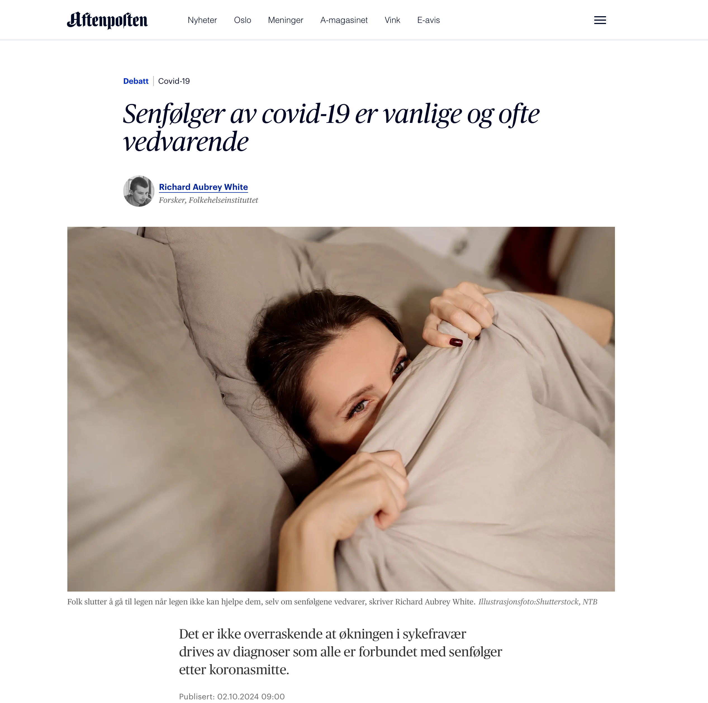

# Long Covid is common and often permanent

*Op-ed • Aftenposten*

Aftenposten

Op-ed

It is not surprising that the increase in sick leave is driven by diagnoses that are all associated with long covid.

Author

[Richard Aubrey White](https://www.rwhite.no) [![](data:image/png;base64,iVBORw0KGgoAAAANSUhEUgAAABAAAAAQCAYAAAAf8/9hAAAAGXRFWHRTb2Z0d2FyZQBBZG9iZSBJbWFnZVJlYWR5ccllPAAAA2ZpVFh0WE1MOmNvbS5hZG9iZS54bXAAAAAAADw/eHBhY2tldCBiZWdpbj0i77u/IiBpZD0iVzVNME1wQ2VoaUh6cmVTek5UY3prYzlkIj8+IDx4OnhtcG1ldGEgeG1sbnM6eD0iYWRvYmU6bnM6bWV0YS8iIHg6eG1wdGs9IkFkb2JlIFhNUCBDb3JlIDUuMC1jMDYwIDYxLjEzNDc3NywgMjAxMC8wMi8xMi0xNzozMjowMCAgICAgICAgIj4gPHJkZjpSREYgeG1sbnM6cmRmPSJodHRwOi8vd3d3LnczLm9yZy8xOTk5LzAyLzIyLXJkZi1zeW50YXgtbnMjIj4gPHJkZjpEZXNjcmlwdGlvbiByZGY6YWJvdXQ9IiIgeG1sbnM6eG1wTU09Imh0dHA6Ly9ucy5hZG9iZS5jb20veGFwLzEuMC9tbS8iIHhtbG5zOnN0UmVmPSJodHRwOi8vbnMuYWRvYmUuY29tL3hhcC8xLjAvc1R5cGUvUmVzb3VyY2VSZWYjIiB4bWxuczp4bXA9Imh0dHA6Ly9ucy5hZG9iZS5jb20veGFwLzEuMC8iIHhtcE1NOk9yaWdpbmFsRG9jdW1lbnRJRD0ieG1wLmRpZDo1N0NEMjA4MDI1MjA2ODExOTk0QzkzNTEzRjZEQTg1NyIgeG1wTU06RG9jdW1lbnRJRD0ieG1wLmRpZDozM0NDOEJGNEZGNTcxMUUxODdBOEVCODg2RjdCQ0QwOSIgeG1wTU06SW5zdGFuY2VJRD0ieG1wLmlpZDozM0NDOEJGM0ZGNTcxMUUxODdBOEVCODg2RjdCQ0QwOSIgeG1wOkNyZWF0b3JUb29sPSJBZG9iZSBQaG90b3Nob3AgQ1M1IE1hY2ludG9zaCI+IDx4bXBNTTpEZXJpdmVkRnJvbSBzdFJlZjppbnN0YW5jZUlEPSJ4bXAuaWlkOkZDN0YxMTc0MDcyMDY4MTE5NUZFRDc5MUM2MUUwNEREIiBzdFJlZjpkb2N1bWVudElEPSJ4bXAuZGlkOjU3Q0QyMDgwMjUyMDY4MTE5OTRDOTM1MTNGNkRBODU3Ii8+IDwvcmRmOkRlc2NyaXB0aW9uPiA8L3JkZjpSREY+IDwveDp4bXBtZXRhPiA8P3hwYWNrZXQgZW5kPSJyIj8+84NovQAAAR1JREFUeNpiZEADy85ZJgCpeCB2QJM6AMQLo4yOL0AWZETSqACk1gOxAQN+cAGIA4EGPQBxmJA0nwdpjjQ8xqArmczw5tMHXAaALDgP1QMxAGqzAAPxQACqh4ER6uf5MBlkm0X4EGayMfMw/Pr7Bd2gRBZogMFBrv01hisv5jLsv9nLAPIOMnjy8RDDyYctyAbFM2EJbRQw+aAWw/LzVgx7b+cwCHKqMhjJFCBLOzAR6+lXX84xnHjYyqAo5IUizkRCwIENQQckGSDGY4TVgAPEaraQr2a4/24bSuoExcJCfAEJihXkWDj3ZAKy9EJGaEo8T0QSxkjSwORsCAuDQCD+QILmD1A9kECEZgxDaEZhICIzGcIyEyOl2RkgwAAhkmC+eAm0TAAAAABJRU5ErkJggg==)](https://orcid.org/0000-0002-6747-1726)

Published

October 2, 2024

Published in [Aftenposten the 2nd of October 2024](https://www.aftenposten.no/meninger/debatt/i/63X530/fhi-tar-feil-senfoelger-av-covid-19-er-vanlige-og-ofte-vedvarende).

*This is a translation of the original Norwegian op-ed, and discrepancies may exist.*

In an article in *Aftenposten* on September 27, Professor and Director Preben Aavitsland at the Norwegian Institute of Public Health (NIPH) claims that long covid is “[rare and often resolves over time](https://www.aftenposten.no/norge/i/3MmpAL/trenger-vi-aa-teste-oss-for-korona).”

This is incorrect — long covid is common and often permanent.

Aavitsland’s claim about duration likely stems from [NIPH’s study](https://www.nature.com/articles/s41467-022-35240-2), which only analyzes the number of general practitioner visits after COVID-19 infection. His interpretation — that fewer visits means the long covid is cured — is [incorrect](https://www.thelancet.com/journals/lancet/article/PIIS0140-6736(24)00744-X/fulltext). People stop going to the doctor when the doctor can’t help them, even if the symptoms persist.

**Cumulative Risk Increases**

A health-based COVID-19 study — which looked at health status rather than doctor visits — recently showed that COVID-19 led to a 6 percent [risk of memory problems](https://www.sciencedirect.com/science/article/pii/S2666354624001352) more than a year later in Norwegians without prior immunity. Vaccination and prior immunity are about [50 percent effective](https://www.nature.com/articles/s41591-024-03173-6) at preventing long covid, so the risk can be reduced to around 3 percent per infection for most people.

The cumulative risk after two infections is then 5.9 percent; after four infections, 11.5 percent; after six infections, 16.7 percent.

This is one example, but several studies show the same result — [repeated infections increase cumulative risk](https://www150.statcan.gc.ca/n1/pub/75-006-x/2023001/article/00015-eng.htm) to an unacceptable level. This must be seen in the context of today’s mass-infection strategy, where people are infected on average once a year.

It is no surprise that the rise in sick leave is driven by three diagnostic codes (A04, P02, and P29), all of which are [associated with long covid](https://www.dagogtid.no/ordskifte/det-er-gode-bevis-for-at-en-stor-del-av-okningen-6.130.36673.58a350ea7c?sharer_id=917982).

**Downplaying the Burden**

The [mass-infection strategy](https://www.regjeringen.no/no/dokumentarkiv/regjeringen-stoere/andre-dokumenter/hod/2023/regjeringens-strategi-og-beredskapsplan-for-handteringen-av-covid-19-pandemien/id2987438/) was supported by [NIPH’s risk assessments](https://www.fhi.no/publ/statusrapporter/risikovurdering-for-luftveisinfeksjoner/), which only considered acute COVID-19. The NIPH has never published a risk assessment of the strategy that includes long covid.

In light of the high rates of sick leave, [likely due to long-term effects](https://www.dagogtid.no/samfunn/kan-det-tenkast-at-sjukefravaret-aukar-fordi-flei-6.129.36438.ae444a490a), those responsible for the strategy — and for the missing risk assessments — have strong incentives to downplay the burden long covid places on society.

We must prevent COVID-19 infections and long covid. This can be done by [improving ventilation](https://www.science.org/doi/full/10.1126/science.adp2241), [using air purifiers](https://www.science.org/doi/full/10.1126/science.adp2241), and recommending the use of [FFP2 respirators](https://journals.asm.org/doi/10.1128/cmr.00124-23) when transmission is high.

*Richard Aubrey White holds a Ph.D. in biostatistics from Harvard University. White is a researcher at the Norwegian Institute of Public Health, but does not speak on behalf of the NIPH.*
