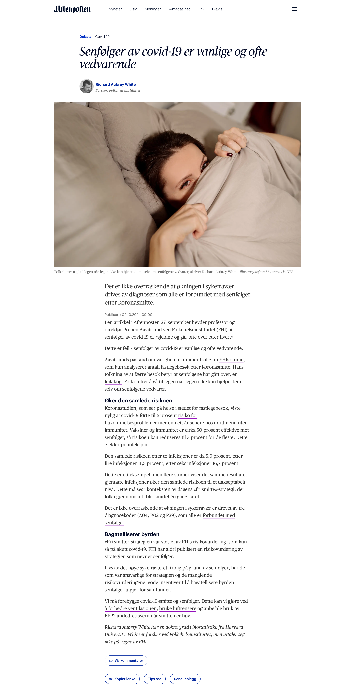

# Senfølger av covid-19 er vanlige og ofte vedvarende

*Op-ed • Aftenposten*

Aftenposten

Op-ed

Det er ikke overraskende at økningen i sykefravær drives av diagnoser som alle er forbundet med senfølger etter koronasmitte.

Author

[Richard Aubrey White](https://www.rwhite.no) [![](data:image/png;base64,iVBORw0KGgoAAAANSUhEUgAAABAAAAAQCAYAAAAf8/9hAAAAGXRFWHRTb2Z0d2FyZQBBZG9iZSBJbWFnZVJlYWR5ccllPAAAA2ZpVFh0WE1MOmNvbS5hZG9iZS54bXAAAAAAADw/eHBhY2tldCBiZWdpbj0i77u/IiBpZD0iVzVNME1wQ2VoaUh6cmVTek5UY3prYzlkIj8+IDx4OnhtcG1ldGEgeG1sbnM6eD0iYWRvYmU6bnM6bWV0YS8iIHg6eG1wdGs9IkFkb2JlIFhNUCBDb3JlIDUuMC1jMDYwIDYxLjEzNDc3NywgMjAxMC8wMi8xMi0xNzozMjowMCAgICAgICAgIj4gPHJkZjpSREYgeG1sbnM6cmRmPSJodHRwOi8vd3d3LnczLm9yZy8xOTk5LzAyLzIyLXJkZi1zeW50YXgtbnMjIj4gPHJkZjpEZXNjcmlwdGlvbiByZGY6YWJvdXQ9IiIgeG1sbnM6eG1wTU09Imh0dHA6Ly9ucy5hZG9iZS5jb20veGFwLzEuMC9tbS8iIHhtbG5zOnN0UmVmPSJodHRwOi8vbnMuYWRvYmUuY29tL3hhcC8xLjAvc1R5cGUvUmVzb3VyY2VSZWYjIiB4bWxuczp4bXA9Imh0dHA6Ly9ucy5hZG9iZS5jb20veGFwLzEuMC8iIHhtcE1NOk9yaWdpbmFsRG9jdW1lbnRJRD0ieG1wLmRpZDo1N0NEMjA4MDI1MjA2ODExOTk0QzkzNTEzRjZEQTg1NyIgeG1wTU06RG9jdW1lbnRJRD0ieG1wLmRpZDozM0NDOEJGNEZGNTcxMUUxODdBOEVCODg2RjdCQ0QwOSIgeG1wTU06SW5zdGFuY2VJRD0ieG1wLmlpZDozM0NDOEJGM0ZGNTcxMUUxODdBOEVCODg2RjdCQ0QwOSIgeG1wOkNyZWF0b3JUb29sPSJBZG9iZSBQaG90b3Nob3AgQ1M1IE1hY2ludG9zaCI+IDx4bXBNTTpEZXJpdmVkRnJvbSBzdFJlZjppbnN0YW5jZUlEPSJ4bXAuaWlkOkZDN0YxMTc0MDcyMDY4MTE5NUZFRDc5MUM2MUUwNEREIiBzdFJlZjpkb2N1bWVudElEPSJ4bXAuZGlkOjU3Q0QyMDgwMjUyMDY4MTE5OTRDOTM1MTNGNkRBODU3Ii8+IDwvcmRmOkRlc2NyaXB0aW9uPiA8L3JkZjpSREY+IDwveDp4bXBtZXRhPiA8P3hwYWNrZXQgZW5kPSJyIj8+84NovQAAAR1JREFUeNpiZEADy85ZJgCpeCB2QJM6AMQLo4yOL0AWZETSqACk1gOxAQN+cAGIA4EGPQBxmJA0nwdpjjQ8xqArmczw5tMHXAaALDgP1QMxAGqzAAPxQACqh4ER6uf5MBlkm0X4EGayMfMw/Pr7Bd2gRBZogMFBrv01hisv5jLsv9nLAPIOMnjy8RDDyYctyAbFM2EJbRQw+aAWw/LzVgx7b+cwCHKqMhjJFCBLOzAR6+lXX84xnHjYyqAo5IUizkRCwIENQQckGSDGY4TVgAPEaraQr2a4/24bSuoExcJCfAEJihXkWDj3ZAKy9EJGaEo8T0QSxkjSwORsCAuDQCD+QILmD1A9kECEZgxDaEZhICIzGcIyEyOl2RkgwAAhkmC+eAm0TAAAAABJRU5ErkJggg==)](https://orcid.org/0000-0002-6747-1726)

Published

October 2, 2024

Publisert i [Aftenposten den 2. oktober 2024](https://www.aftenposten.no/meninger/debatt/i/63X530/fhi-tar-feil-senfoelger-av-covid-19-er-vanlige-og-ofte-vedvarende).

I en artikkel i *Aftenposten* 27. september hevder professor og direktør Preben Aavitsland ved Folkehelseinstituttet (FHI) at senfølger av covid-19 er «[sjeldne og går ofte over etter hvert](https://www.aftenposten.no/norge/i/3MmpAL/trenger-vi-aa-teste-oss-for-korona)».

Dette er feil — senfølger av covid-19 er vanlige og ofte vedvarende.

Aavitslands påstand om varigheten kommer trolig fra [FHIs studie](https://www.nature.com/articles/s41467-022-35240-2), som kun analyserer antall fastlegebesøk etter koronasmitte. Hans tolkning av at færre besøk betyr at senfølgene har gått over, [er feilaktig](https://www.thelancet.com/journals/lancet/article/PIIS0140-6736(24)00744-X/fulltext). Folk slutter å gå til legen når legen ikke kan hjelpe dem, selv om senfølgene vedvarer.

**Øker den samlede risikoen**

Koronastudien, som ser på helse i stedet for fastlegebesøk, viste nylig at covid-19 førte til 6 prosent [risiko for hukommelsesproblemer](https://www.sciencedirect.com/science/article/pii/S2666354624001352) mer enn ett år senere hos nordmenn uten immunitet. Vaksiner og immunitet er cirka [50 prosent effektive](https://www.nature.com/articles/s41591-024-03173-6) mot senfølger, så risikoen kan reduseres til 3 prosent for de fleste. Dette gjelder pr. infeksjon.

Den samlede risikoen etter to infeksjoner er da 5,9 prosent, etter fire infeksjoner 11,5 prosent, etter seks infeksjoner 16,7 prosent.

Dette er ett eksempel, men flere studier viser det samme resultatet — [gjentatte infeksjoner øker den samlede risikoen](https://www150.statcan.gc.ca/n1/pub/75-006-x/2023001/article/00015-eng.htm) til et uakseptabelt nivå. Dette må ses i konteksten av dagens «fri smitte»-strategi, der folk i gjennomsnitt blir smittet én gang i året.

Det er ikke overraskende at økningen i sykefravær er drevet av tre diagnosekoder (A04, P02 og P29), som alle er [forbundet med senfølger](https://www.dagogtid.no/ordskifte/det-er-gode-bevis-for-at-en-stor-del-av-okningen-6.130.36673.58a350ea7c?sharer_id=917982).

**Bagatelliserer byrden**

[«Fri smitte»-strategien](https://www.regjeringen.no/no/dokumentarkiv/regjeringen-stoere/andre-dokumenter/hod/2023/regjeringens-strategi-og-beredskapsplan-for-handteringen-av-covid-19-pandemien/id2987438/) var støttet av [FHIs risikovurdering](https://www.fhi.no/publ/statusrapporter/risikovurdering-for-luftveisinfeksjoner/), som kun så på akutt covid-19. FHI har aldri publisert en risikovurdering av strategien som nevner senfølger.

I lys av det høye sykefraværet, [trolig på grunn av senfølger](https://www.dagogtid.no/samfunn/kan-det-tenkast-at-sjukefravaret-aukar-fordi-flei-6.129.36438.ae444a490a), har de som var ansvarlige for strategien og de manglende risikovurderingene, gode insentiver til å bagatellisere byrden senfølger utgjør for samfunnet.

Vi må forebygge covid-19-smitte og senfølger. Dette kan vi gjøre ved [å forbedre ventilasjonen](https://www.science.org/doi/full/10.1126/science.adp2241), [bruke luftrensere](https://www.science.org/doi/full/10.1126/science.adp2241) og anbefale bruk av [FFP2-åndedrettsvern](https://journals.asm.org/doi/10.1128/cmr.00124-23) når smitten er høy.

*Richard Aubrey White har en doktorgrad i biostatistikk fra Harvard University. White er forsker ved Folkehelseinstituttet, men uttaler seg ikke på vegne av FHI.*
