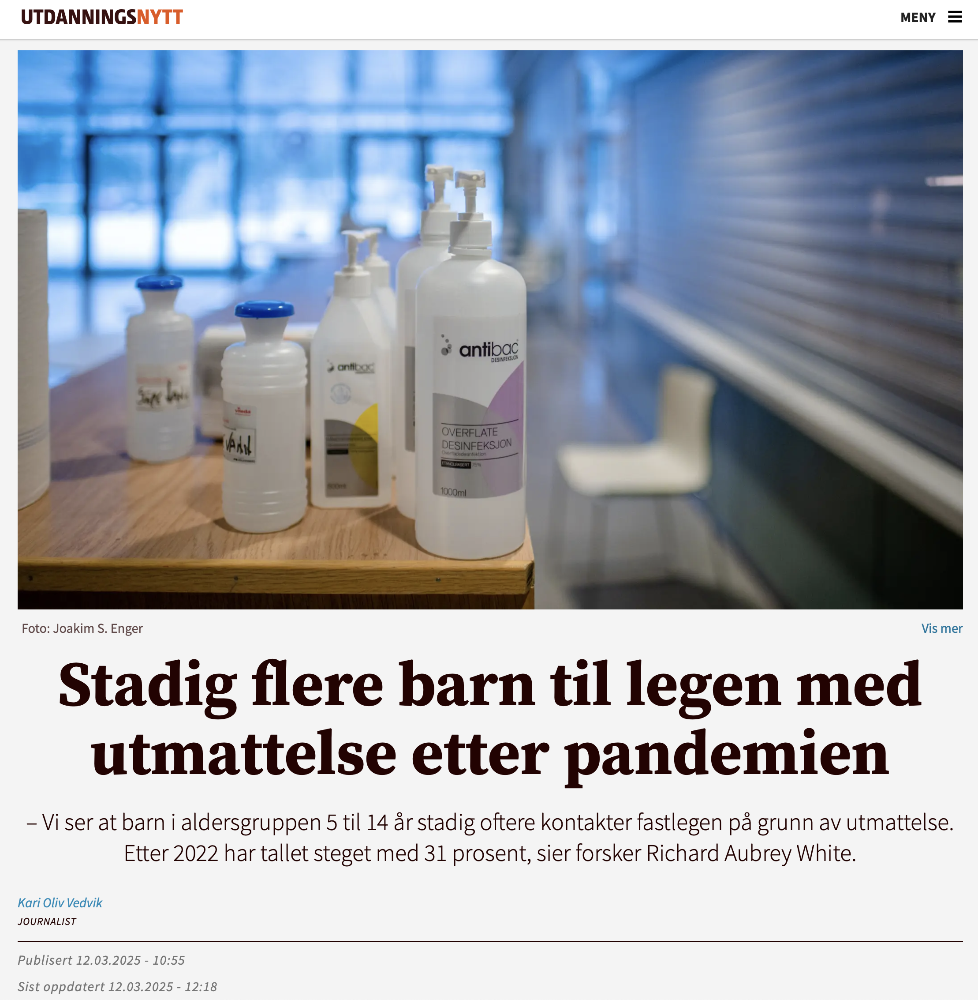

# Stadig flere barn til legen med utmattelse etter pandemien

*In the media • Utdanningsnytt*

Utdanningsnytt

In the media

Vi ser at barn i aldersgruppen 5 til 14 år stadig oftere kontakter fastlegen på grunn av utmattelse. Etter 2022 har tallet steget med 31 prosent, sier forsker Richard Aubrey White.

Published

March 12, 2025

[Publisert på Utdanningsnytt den 12. mars 2025](https://www.utdanningsnytt.no/covid-helsesykepleier-korona/stadig-flere-barn-til-legen-med-utmattelse-etter-pandemien/434924).
