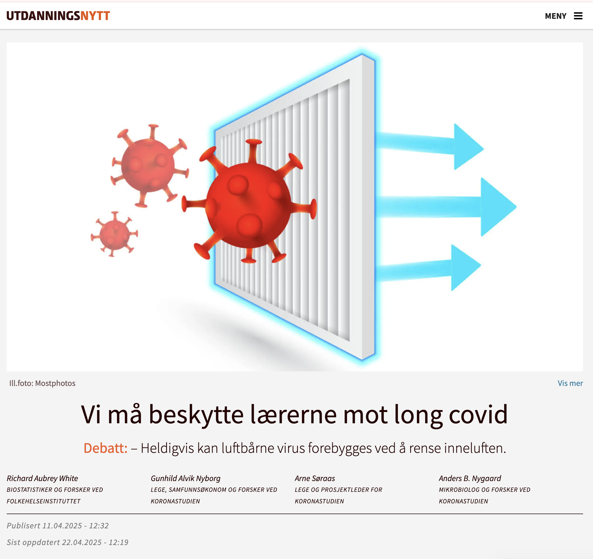
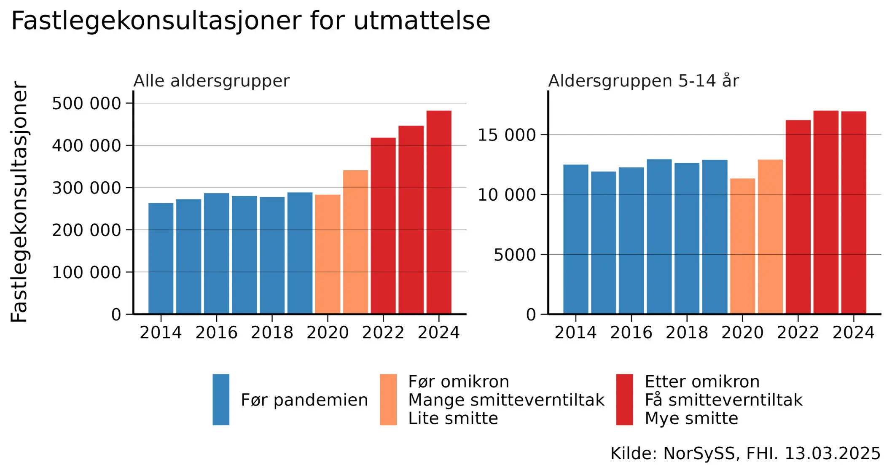

# Vi må beskytte lærerne mot long covid

*Op-ed • Utdanningsnytt*

Op-ed

Utdanningsnytt

Heldigvis kan luftbårne virus forebygges ved å rense inneluften.

Author

[Richard Aubrey White](https://www.rwhite.no) [![](data:image/png;base64,iVBORw0KGgoAAAANSUhEUgAAABAAAAAQCAYAAAAf8/9hAAAAGXRFWHRTb2Z0d2FyZQBBZG9iZSBJbWFnZVJlYWR5ccllPAAAA2ZpVFh0WE1MOmNvbS5hZG9iZS54bXAAAAAAADw/eHBhY2tldCBiZWdpbj0i77u/IiBpZD0iVzVNME1wQ2VoaUh6cmVTek5UY3prYzlkIj8+IDx4OnhtcG1ldGEgeG1sbnM6eD0iYWRvYmU6bnM6bWV0YS8iIHg6eG1wdGs9IkFkb2JlIFhNUCBDb3JlIDUuMC1jMDYwIDYxLjEzNDc3NywgMjAxMC8wMi8xMi0xNzozMjowMCAgICAgICAgIj4gPHJkZjpSREYgeG1sbnM6cmRmPSJodHRwOi8vd3d3LnczLm9yZy8xOTk5LzAyLzIyLXJkZi1zeW50YXgtbnMjIj4gPHJkZjpEZXNjcmlwdGlvbiByZGY6YWJvdXQ9IiIgeG1sbnM6eG1wTU09Imh0dHA6Ly9ucy5hZG9iZS5jb20veGFwLzEuMC9tbS8iIHhtbG5zOnN0UmVmPSJodHRwOi8vbnMuYWRvYmUuY29tL3hhcC8xLjAvc1R5cGUvUmVzb3VyY2VSZWYjIiB4bWxuczp4bXA9Imh0dHA6Ly9ucy5hZG9iZS5jb20veGFwLzEuMC8iIHhtcE1NOk9yaWdpbmFsRG9jdW1lbnRJRD0ieG1wLmRpZDo1N0NEMjA4MDI1MjA2ODExOTk0QzkzNTEzRjZEQTg1NyIgeG1wTU06RG9jdW1lbnRJRD0ieG1wLmRpZDozM0NDOEJGNEZGNTcxMUUxODdBOEVCODg2RjdCQ0QwOSIgeG1wTU06SW5zdGFuY2VJRD0ieG1wLmlpZDozM0NDOEJGM0ZGNTcxMUUxODdBOEVCODg2RjdCQ0QwOSIgeG1wOkNyZWF0b3JUb29sPSJBZG9iZSBQaG90b3Nob3AgQ1M1IE1hY2ludG9zaCI+IDx4bXBNTTpEZXJpdmVkRnJvbSBzdFJlZjppbnN0YW5jZUlEPSJ4bXAuaWlkOkZDN0YxMTc0MDcyMDY4MTE5NUZFRDc5MUM2MUUwNEREIiBzdFJlZjpkb2N1bWVudElEPSJ4bXAuZGlkOjU3Q0QyMDgwMjUyMDY4MTE5OTRDOTM1MTNGNkRBODU3Ii8+IDwvcmRmOkRlc2NyaXB0aW9uPiA8L3JkZjpSREY+IDwveDp4bXBtZXRhPiA8P3hwYWNrZXQgZW5kPSJyIj8+84NovQAAAR1JREFUeNpiZEADy85ZJgCpeCB2QJM6AMQLo4yOL0AWZETSqACk1gOxAQN+cAGIA4EGPQBxmJA0nwdpjjQ8xqArmczw5tMHXAaALDgP1QMxAGqzAAPxQACqh4ER6uf5MBlkm0X4EGayMfMw/Pr7Bd2gRBZogMFBrv01hisv5jLsv9nLAPIOMnjy8RDDyYctyAbFM2EJbRQw+aAWw/LzVgx7b+cwCHKqMhjJFCBLOzAR6+lXX84xnHjYyqAo5IUizkRCwIENQQckGSDGY4TVgAPEaraQr2a4/24bSuoExcJCfAEJihXkWDj3ZAKy9EJGaEo8T0QSxkjSwORsCAuDQCD+QILmD1A9kECEZgxDaEZhICIzGcIyEyOl2RkgwAAhkmC+eAm0TAAAAABJRU5ErkJggg==)](https://orcid.org/0000-0002-6747-1726)

Published

April 22, 2025

Publisert på [Utdanningsnytt den 22. april 2025](https://www.utdanningsnytt.no/covid-luftfiltrering-luftsmitte/vi-ma-beskytte-laererne-mot-long-covid/438378).

Den 12. mars 2025 markerte et [historisk øyeblikk](https://www.nrk.no/buskerud/erna-solberg-vil-at-norge-skal-ta-et-nytt-koronagrep-for-a-takle-_long-covid_-1.17336151) for norsk folkehelse. Erna Solberg anerkjente at long covid kan være en viktig årsak til [økningen i sykefraværet](https://frifagbevegelse.no/debatt/debatten-om-sykefravar-er-fort-pa-feil-premisser-6.490.1106983.a33706873a) og kom med et valgløfte om å forbedre behandlingen.

Men behandling er bare halve løsningen. Vi må også forebygge.

[Long covid skyldes koronainfeksjoner](https://www.nrk.no/ytring/covid-er-farligere-enn-du-tror-1.17116008). Jo oftere folk blir smittet, desto flere vil utvikle long covid. Hvis vi reduserer smitten, vil færre bli kronisk syke.

Tidlig i pandemien trodde man feilaktig at koronaviruset spredte seg via dråper. Nå vet vi at [koronaviruset er luftbårent](https://www.nature.com/articles/s41598-023-47829-8) – det sprer seg i luften som røyk. Heldigvis kan luftbårne virus forebygges ved å rense inneluften.

Florence Nightingale skrev i 1859: «Den aller første regelen for sykepleie: Hold luften han puster så ren som uteluften.» Dette prinsippet bør vi strebe etter også i dag. Ved å rense luften kan vi forebygge luftveisinfeksjoner, allergiplager og annet ubehag.

Vi har tre effektive metoder for å rense inneluften: ventilasjon, filtrering og UVC-lys.

- Ventilasjon tilfører frisk luft, ideelt gjennom balansert ventilasjon.
- Luftfiltrering fjerner luftbårne virus ved hjelp av luftrensere. Finland har med suksess brukt dette i [barnehager for å redusere sykefravær](https://yle.fi/a/74-20062381). FHI og SINTEF [forsker på om luftfiltrering kan forebygge infeksjoner med det nye koronaviruset](https://www.fhi.no/sm/luftrenserstudien/), men forskningen [tar tid](https://trialsjournal.biomedcentral.com/articles/10.1186/s13063-024-08547-2).
- UVC-lys har i flere tiår vært brukt i skoler og sykehus for å hindre spredning av [meslinger, tuberkulose og influensa](https://pmc.ncbi.nlm.nih.gov/articles/PMC2789813/). Nyere «[far UVC](https://www.nature.com/articles/s41598-022-08462-z)»-teknologi er enda tryggere og lettere å installere i høyt trafikkerte områder som kollektivtransport og korridorer. [Danske ambulanser](https://uvmedico.com/news/uv-medico-falck-elevating-ambulance-safety-with-uv222-technology) og [det amerikanske forsvaret](https://www.defense.gov/News/Feature-Stories/Story/Article/2309289/air-guard-wing-receives-dods-first-uv-light-disinfectant-system/) bruker allerede denne teknologien.

**En «inneklima»-revolusjon skjer nå over hele verden – men Norge henger etter**

Biden-administrasjonen utviklet, som en konsekvens av pandemien, nye [inneklimastandarder for å beskytte folkehelsen](https://www.ashrae.org/about/news/2023/ashrae-approves-groundbreaking-standard-to-reduce-the-risk-of-disease-transmission-in-indoor-spaces). Japanske restauranter viser målinger av [luftkvalitet i sanntid](https://x.com/ToshiAkima/status/1488150477993025542). [Australia har nylig vedtatt en lov](https://www.parliament.nsw.gov.au/Hansard/Pages/HansardResult.aspx#/docid/HANSARD-1820781676-98120/link/2300) som slår fast at «elever og ansatte i offentlige skoler fortjener et trygt læringsmiljø, inkludert god luftkvalitet … Dårlig ventilerte innendørsrom øker spredningen av luftbårne sykdommer og utgjør en risiko for unge mennesker, ansatte og hele samfunnet.»

Mens andre land handler, henger Norge etter. Folkehelseinstituttets [fagmiljø for inneklima](https://www.dagensmedisin.no/fhi-folkehelseinstituttet-inneklima/fhi-kutter-inneklima-fagmiljo/531987) ble lagt ned, i en periode hvor antallet koronainfeksjoner økte betydelig. I tiden etter, har fastlegekonsultasjoner for utmattelse og [sykefravær knyttet til long covid](https://archpublichealth.biomedcentral.com/articles/10.1186/s13690-024-01411-4) økt kraftig. Disse plagene rammer ikke bare voksne, men [også barn](https://publications.aap.org/pediatrics/article/153/3/e2023062570/196606/Postacute-Sequelae-of-SARS-CoV-2-in-Children?autologincheck=redirected), som stadig smittes i [skoler med dårlig inneklima](https://www.nrk.no/vestland/230.000-norske-elevar-i-klasserom-med-darleg-luft-1.15993604) og risikerer langvarige helseplager.

 **Lærere er utsatt — long covid kan være en yrkesskade**

Barna smitter ikke bare hverandre — de kan også smitte familiene sine, og lærerne sine, selv når barna [selv ikke har symptomer](https://academic.oup.com/cid/article/78/6/1522/7634443). Noen av dem får også long covid. 36 % av [skademeldinger knyttet til covid-19](https://www.nav.no/no/nav-og-samfunn/statistikk/flere-statistikkomrader/relatert-informasjon/mottatte-skademeldinger-knyttet-til-covid-19) har kommet fra lærere, barnehageansatte og andre skoleansatte. [Long covid kan være en yrkesskade](https://www.utdanningsnytt.no/corona-inneklima-korona/sykdommen-som-ikke-gikk-over/434365). Fagforeningene må ta grep for å sikre at skolene blir trygge arbeidsplasser. Denne typen smitte kan i noen grad forebygges ved bedret luftrensing eller ventilasjon i skoler og barnehage.

**Godt inneklima er avgjørende for Norges beredskap**

Forbedret inneklima handler ikke bare om trivsel, helse, luftkvalitet eller å forebygge long covid i dag. Det er også viktig for Norges beredskap. Vi vet at det vil komme nye pandemier. Dersom vi nå tar et løft for å få sikrere inneklima i norske skoler, barnehager og andre offentlige bygg, vil vi være bedre beskyttet neste gang. Det vil fungere som et smittereduserende tiltak, men det vil også bidra til å begrense behovet for nedstengninger. Et bedre inneklima beskytter oss mot den stadig mer sannsynlige [fugleinfluensa-pandemien](https://www.vg.no/nyheter/i/nybJrB/fugleinfluensa-norge-har-sikret-seg-vaksineavtale) – og andre fremtidige luftbårne pandemier.

Norge har mye å vinne på å handle nå. Vil norske politikere bidra til å sikre Norges folkehelse, arbeidskraft og beredskap – eller la Norge bli hengende etter?

*Richard Aubrey White skriver ikke på vegne av FHI.*
