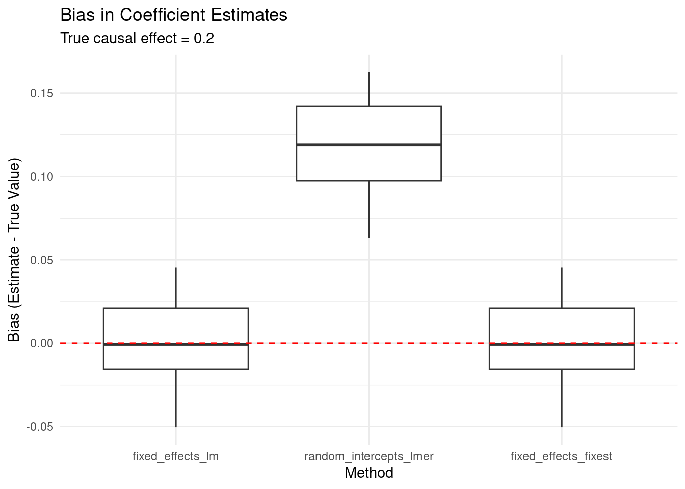

# Random intercepts do not fix confounding

A common misconception in epidemiology is that random intercepts can fix confounding. This post demonstrates through simulation that this is not the case, and provides guidance on when random intercepts should be used.

Author

[Richard Aubrey White](https://www.rwhite.no) [![](data:image/png;base64,iVBORw0KGgoAAAANSUhEUgAAABAAAAAQCAYAAAAf8/9hAAAAGXRFWHRTb2Z0d2FyZQBBZG9iZSBJbWFnZVJlYWR5ccllPAAAA2ZpVFh0WE1MOmNvbS5hZG9iZS54bXAAAAAAADw/eHBhY2tldCBiZWdpbj0i77u/IiBpZD0iVzVNME1wQ2VoaUh6cmVTek5UY3prYzlkIj8+IDx4OnhtcG1ldGEgeG1sbnM6eD0iYWRvYmU6bnM6bWV0YS8iIHg6eG1wdGs9IkFkb2JlIFhNUCBDb3JlIDUuMC1jMDYwIDYxLjEzNDc3NywgMjAxMC8wMi8xMi0xNzozMjowMCAgICAgICAgIj4gPHJkZjpSREYgeG1sbnM6cmRmPSJodHRwOi8vd3d3LnczLm9yZy8xOTk5LzAyLzIyLXJkZi1zeW50YXgtbnMjIj4gPHJkZjpEZXNjcmlwdGlvbiByZGY6YWJvdXQ9IiIgeG1sbnM6eG1wTU09Imh0dHA6Ly9ucy5hZG9iZS5jb20veGFwLzEuMC9tbS8iIHhtbG5zOnN0UmVmPSJodHRwOi8vbnMuYWRvYmUuY29tL3hhcC8xLjAvc1R5cGUvUmVzb3VyY2VSZWYjIiB4bWxuczp4bXA9Imh0dHA6Ly9ucy5hZG9iZS5jb20veGFwLzEuMC8iIHhtcE1NOk9yaWdpbmFsRG9jdW1lbnRJRD0ieG1wLmRpZDo1N0NEMjA4MDI1MjA2ODExOTk0QzkzNTEzRjZEQTg1NyIgeG1wTU06RG9jdW1lbnRJRD0ieG1wLmRpZDozM0NDOEJGNEZGNTcxMUUxODdBOEVCODg2RjdCQ0QwOSIgeG1wTU06SW5zdGFuY2VJRD0ieG1wLmlpZDozM0NDOEJGM0ZGNTcxMUUxODdBOEVCODg2RjdCQ0QwOSIgeG1wOkNyZWF0b3JUb29sPSJBZG9iZSBQaG90b3Nob3AgQ1M1IE1hY2ludG9zaCI+IDx4bXBNTTpEZXJpdmVkRnJvbSBzdFJlZjppbnN0YW5jZUlEPSJ4bXAuaWlkOkZDN0YxMTc0MDcyMDY4MTE5NUZFRDc5MUM2MUUwNEREIiBzdFJlZjpkb2N1bWVudElEPSJ4bXAuZGlkOjU3Q0QyMDgwMjUyMDY4MTE5OTRDOTM1MTNGNkRBODU3Ii8+IDwvcmRmOkRlc2NyaXB0aW9uPiA8L3JkZjpSREY+IDwveDp4bXBtZXRhPiA8P3hwYWNrZXQgZW5kPSJyIj8+84NovQAAAR1JREFUeNpiZEADy85ZJgCpeCB2QJM6AMQLo4yOL0AWZETSqACk1gOxAQN+cAGIA4EGPQBxmJA0nwdpjjQ8xqArmczw5tMHXAaALDgP1QMxAGqzAAPxQACqh4ER6uf5MBlkm0X4EGayMfMw/Pr7Bd2gRBZogMFBrv01hisv5jLsv9nLAPIOMnjy8RDDyYctyAbFM2EJbRQw+aAWw/LzVgx7b+cwCHKqMhjJFCBLOzAR6+lXX84xnHjYyqAo5IUizkRCwIENQQckGSDGY4TVgAPEaraQr2a4/24bSuoExcJCfAEJihXkWDj3ZAKy9EJGaEo8T0QSxkjSwORsCAuDQCD+QILmD1A9kECEZgxDaEZhICIzGcIyEyOl2RkgwAAhkmC+eAm0TAAAAABJRU5ErkJggg==)](https://orcid.org/0000-0002-6747-1726)

Published

July 14, 2025

# Introduction

Mixed effects models are a crucial tool in the modern epidemiologist’s toolbox. They allow for the estimation of both fixed and random effects, which can help to account for the correlation structure in the data. However, it is a common misconception that random intercepts can fix epidemiological confounding.

This post will use `lme4` and `rstanarm` to demonstrate that this is not the case, and then provide some guidance on how to properly adjust for confounding and when random intercepts should be used.

A common aim in the field of epidemiology is to precisely measure the association between two variables, typically referred to as the outcome and exposure. The estimation of this association is typically biased due to confounders. A confounder is defined as an independent variable that is associated with both the outcome and the exposure. The presence of a confounder can lead to biased estimates of the exposure-outcome association, unless it is appropriately taken into account.

## Mathematical framework

Consider the following simple linear regression model:

\\ \text{Formula 1: } Y_i = \beta_0 + \beta_1 X_i + \epsilon_i,\\ i=1 \dots n \\

where \\Y_i\\ is the outcome, \\X_i\\ is the exposure, and \\\epsilon_i\\ is the error term. The parameter of interest is \\\beta_1\\, which represents the association between the exposure and the outcome.

Now, if there is a confounder \\C_i\\ that is associated with both \\X\\ and \\Y\\, then the estimate of \\\beta_1\\ in Formula 1 will be biased. An unbiased estimate of \\\beta_1\\ can be obtained by adjusting for the confounder:

\\ \text{Formula 2: } Y_i = \beta_0 + \beta_1 X_i + \beta_2 C_i + \epsilon_i,\\ i=1 \dots n \\

When there are no unmeasured confounders, \\\beta_1\\ can be considered to be the conditional causal effect of \\X\\ on \\Y\\ given \\C\\.

\\ \text{Formula 3: } \beta_1 = E\[Y\|X, C=1\] - E\[Y\|X, C=0\] \\

A more complex situation occurs when there are multiple clusters in the data, such as patients within hospitals, or students within schools. In this case, a random intercept can be added to the model to account for the correlation within clusters:

\\ \text{Formula 4: } Y\_{ij} = \beta_0 + u\_{0j} + \beta_1 X\_{ij} + \epsilon\_{ij} \\

where \\u\_{0j} \sim N(0, \sigma_u^2)\\ represents the random intercept for cluster \\j\\, and \\\epsilon\_{ij} \sim N(0, \sigma_e^2)\\ represents the individual-level error term.

The key question is: **Does the random intercept \\u\_{0j}\\ adequately control for cluster-level confounding?**

# Simulation study

Let’s demonstrate through simulation that random intercepts do not fix confounding when the confounder varies at the cluster level.

``` r
# Load required libraries
library(data.table)
library(ggplot2)
library(magrittr)
library(lme4)
library(fixest)

set.seed(123)

# Parameters
n_clusters <- 500
cluster_size <- 20
n <- n_clusters * cluster_size

# Cluster IDs
cluster_id <- rep(1:n_clusters, each = cluster_size)

# We'll run multiple simulations to get stable results
raw <- vector("list", length = 20)

for(i in seq_along(raw)){
  cat("Simulation", i, "\n")
  
  # Strong cluster-level confounder
  U_cluster <- rnorm(n_clusters, mean = 0, sd = 1)
  U <- U_cluster[cluster_id]

  # Simulate exposure with strong effect from U
  # Weak individual-level noise
  X <- 0.8 * U + rnorm(n, mean = 0, sd = 0.5)

  # Simulate outcome with strong U effect and weak X effect
  # TRUE causal effect of X on Y is 0.2
  Y <- 1.5 * U + 0.2 * X + rnorm(n, mean = 0, sd = 1)

  # Put in a data frame
  dat <- data.frame(cluster_id, U, X, Y)

  # Compare different modeling approaches
  fit_lm <- coef(lm(Y ~ X + factor(cluster_id), data = dat))[2]  # Fixed effects
  fit_lmer <- coef(lme4::lmer(Y ~ X + (1 | cluster_id), data = dat))$cluster_id[1,2]  # Random intercepts
  fit_fixest <- fixest::feols(Y ~ X | cluster_id, data = dat)$coefficients[["X"]]  # Fixed effects (alternative)

  raw[[i]] <- data.frame(
    real_value = 0.2,
    fixed_effects_lm = fit_lm,
    random_intercepts_lmer = fit_lmer,
    fixed_effects_fixest = fit_fixest
  )
}
```

    Simulation 1 
    Simulation 2 
    Simulation 3 
    Simulation 4 
    Simulation 5 
    Simulation 6 
    Simulation 7 
    Simulation 8 
    Simulation 9 
    Simulation 10 
    Simulation 11 
    Simulation 12 
    Simulation 13 
    Simulation 14 
    Simulation 15 
    Simulation 16 
    Simulation 17 
    Simulation 18 
    Simulation 19 
    Simulation 20 

``` r
# Combine results
results <- rbindlist(raw)
results[, id := 1:.N]
results_long <- melt.data.table(results, id.vars = c("id", "real_value"))
results_long[, deviance := value - real_value]

# Calculate mean bias for each method
bias_summary <- results_long[, .(mean_bias = mean(deviance)), by = .(variable)]
print(bias_summary)
```

                     variable    mean_bias
                       <fctr>        <num>
    1:       fixed_effects_lm 0.0003475138
    2: random_intercepts_lmer 0.1177147529
    3:   fixed_effects_fixest 0.0003475138

## Results interpretation

The simulation results show:



The key findings are:

1.  **Fixed effects models** (both `lm` with cluster dummies and `fixest`) correctly estimate the causal effect with minimal bias
2.  **Random intercepts models** show substantial bias, failing to adequately control for the cluster-level confounder

This demonstrates that when confounding occurs at the cluster level, random intercepts do not provide adequate control for confounding, while fixed effects do.

# When to use random vs fixed rffects

## Use random intercepts when:

- You want to make inferences about the population of clusters (not just the observed clusters).
- The clusters are a random sample from a larger population.
- You’re primarily interested in individual-level effects.
- The cluster-level variables are not confounders.

## Use fixed effects when:

- You want to control for all time-invariant cluster-level confounders.
- You’re making inferences about the specific clusters in your data.
- The cluster-level variables are potential confounders.
- You want the most robust estimate of the exposure effect.

# Conclusion

Random intercepts are a powerful tool for accounting for correlation within clusters, but they do not fix confounding when the confounder varies at the cluster level. When cluster-level confounding is a concern, fixed effects models provide more robust estimates of causal effects.

The choice between random and fixed effects should be guided by:

1.  The causal structure of your data
2.  Whether cluster-level variables are confounders
3.  Your inferential goals (population vs. sample-specific inferences)

Understanding this distinction is crucial for proper epidemiological analysis and avoiding biased estimates of causal effects.
