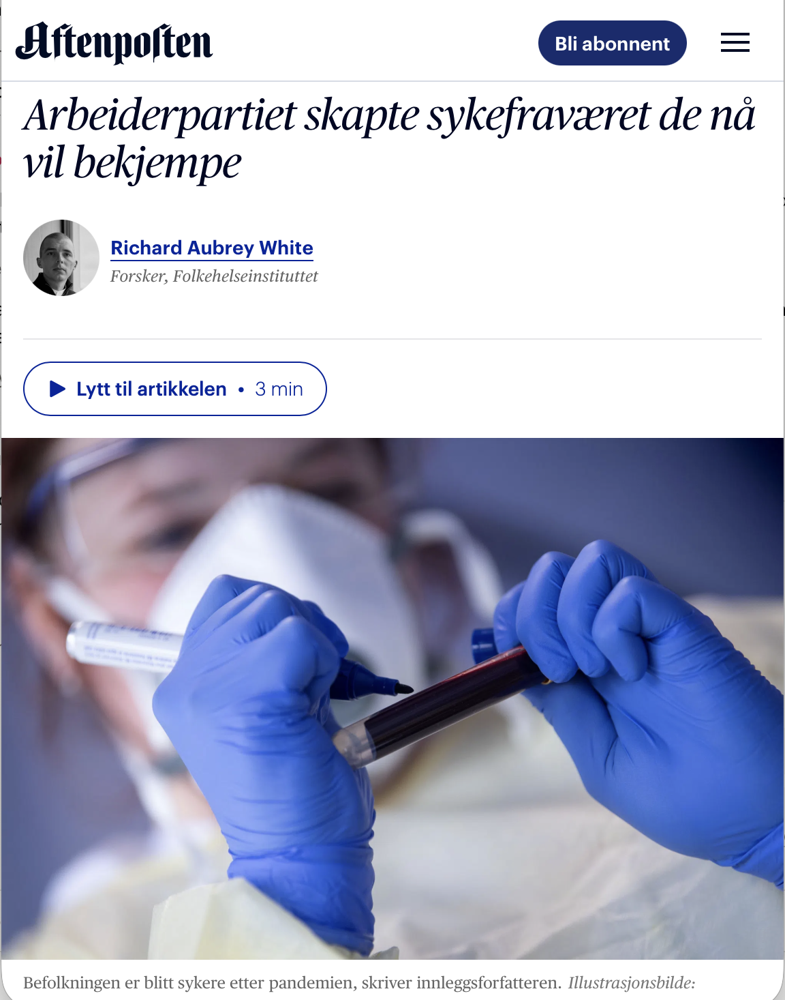

# Arbeiderpartiet skapte sykefraværet de nå vil bekjempe

*Op-ed • Aftenposten*

Op-ed

Aftenposten

Det Ap fremstiller som et kulturproblem, er en målbar konsekvens av deres egen koronastrategi.

Author

[Richard Aubrey White](https://www.rwhite.no) [![](data:image/png;base64,iVBORw0KGgoAAAANSUhEUgAAABAAAAAQCAYAAAAf8/9hAAAAGXRFWHRTb2Z0d2FyZQBBZG9iZSBJbWFnZVJlYWR5ccllPAAAA2ZpVFh0WE1MOmNvbS5hZG9iZS54bXAAAAAAADw/eHBhY2tldCBiZWdpbj0i77u/IiBpZD0iVzVNME1wQ2VoaUh6cmVTek5UY3prYzlkIj8+IDx4OnhtcG1ldGEgeG1sbnM6eD0iYWRvYmU6bnM6bWV0YS8iIHg6eG1wdGs9IkFkb2JlIFhNUCBDb3JlIDUuMC1jMDYwIDYxLjEzNDc3NywgMjAxMC8wMi8xMi0xNzozMjowMCAgICAgICAgIj4gPHJkZjpSREYgeG1sbnM6cmRmPSJodHRwOi8vd3d3LnczLm9yZy8xOTk5LzAyLzIyLXJkZi1zeW50YXgtbnMjIj4gPHJkZjpEZXNjcmlwdGlvbiByZGY6YWJvdXQ9IiIgeG1sbnM6eG1wTU09Imh0dHA6Ly9ucy5hZG9iZS5jb20veGFwLzEuMC9tbS8iIHhtbG5zOnN0UmVmPSJodHRwOi8vbnMuYWRvYmUuY29tL3hhcC8xLjAvc1R5cGUvUmVzb3VyY2VSZWYjIiB4bWxuczp4bXA9Imh0dHA6Ly9ucy5hZG9iZS5jb20veGFwLzEuMC8iIHhtcE1NOk9yaWdpbmFsRG9jdW1lbnRJRD0ieG1wLmRpZDo1N0NEMjA4MDI1MjA2ODExOTk0QzkzNTEzRjZEQTg1NyIgeG1wTU06RG9jdW1lbnRJRD0ieG1wLmRpZDozM0NDOEJGNEZGNTcxMUUxODdBOEVCODg2RjdCQ0QwOSIgeG1wTU06SW5zdGFuY2VJRD0ieG1wLmlpZDozM0NDOEJGM0ZGNTcxMUUxODdBOEVCODg2RjdCQ0QwOSIgeG1wOkNyZWF0b3JUb29sPSJBZG9iZSBQaG90b3Nob3AgQ1M1IE1hY2ludG9zaCI+IDx4bXBNTTpEZXJpdmVkRnJvbSBzdFJlZjppbnN0YW5jZUlEPSJ4bXAuaWlkOkZDN0YxMTc0MDcyMDY4MTE5NUZFRDc5MUM2MUUwNEREIiBzdFJlZjpkb2N1bWVudElEPSJ4bXAuZGlkOjU3Q0QyMDgwMjUyMDY4MTE5OTRDOTM1MTNGNkRBODU3Ii8+IDwvcmRmOkRlc2NyaXB0aW9uPiA8L3JkZjpSREY+IDwveDp4bXBtZXRhPiA8P3hwYWNrZXQgZW5kPSJyIj8+84NovQAAAR1JREFUeNpiZEADy85ZJgCpeCB2QJM6AMQLo4yOL0AWZETSqACk1gOxAQN+cAGIA4EGPQBxmJA0nwdpjjQ8xqArmczw5tMHXAaALDgP1QMxAGqzAAPxQACqh4ER6uf5MBlkm0X4EGayMfMw/Pr7Bd2gRBZogMFBrv01hisv5jLsv9nLAPIOMnjy8RDDyYctyAbFM2EJbRQw+aAWw/LzVgx7b+cwCHKqMhjJFCBLOzAR6+lXX84xnHjYyqAo5IUizkRCwIENQQckGSDGY4TVgAPEaraQr2a4/24bSuoExcJCfAEJihXkWDj3ZAKy9EJGaEo8T0QSxkjSwORsCAuDQCD+QILmD1A9kECEZgxDaEZhICIzGcIyEyOl2RkgwAAhkmC+eAm0TAAAAABJRU5ErkJggg==)](https://orcid.org/0000-0002-6747-1726)

Published

April 27, 2026

Publisert i [Aftenposten den 27. april 2026](https://www.aftenposten.no/meninger/debatt/i/JOnbx4/richard-aubrey-white-ap-skylder-nordmenn-en-helsestrategi-og-huske-pandemien).

Arbeidsminister Kjersti Stenseng og helseminister Jan Christian Vestre, begge fra Arbeiderpartiet, mener det er blitt for lett å få sykmelding. Stenseng minner oss om at «livet er kjipt innimellom». Men det de fremstiller som et kulturproblem, er en målbar konsekvens av deres egen koronastrategi.

Siden 2022 har Norge basert koronastrategien sin på at befolkningen skal opprettholde immunitet gjennom gjentatte reinfeksjoner. Folkehelseinstituttet har selv dokumentert 6 prosent risiko for senfølger av covid-19 ved første infeksjon, og risikoen går ikke ned ved reinfeksjon.

Med en befolkning som er reinfisert gjentatte ganger, må vi vente at flere hundre tusen nordmenn er rammet. Likevel er senfølger ikke nevnt i policydokumentene. Vi tester ikke befolkningen, og det finnes ikke engang en diagnosekode for senfølger.

I tre fagfellevurderte studier har jeg dokumentert konsekvensene. Fastlegekonsultasjoner og sykefravær har økt. De er drevet av diagnoser som er kjente symptomer på senfølger. Økningene følger koronabølgene. Og vi har hatt 11.500 flere dødsfall enn ventet siden koronastrategien ble innført.

Dette er heller ikke et særnorsk fenomen. Sykefraværet i Europa ligger i 2024 fortsatt på nivå med 2020 – pandemiens første år. Å ignorere koronaviruset har ikke spart oss for konsekvensene. Vi topper europeisk sykefraværsstatistikk ikke fordi nordmenn er blitt late, men fordi systemet lar folk ta det sykefraværet de trenger – i en befolkning som målbart er sykere enn før pandemien.

Hvordan en pasient kodes, avhenger av hva fastlegen vet. En pasient som har testet positivt for covid-19, kan få utmattelse (A04) som diagnose. Den samme pasienten uten test – fordi ingen tester lenger – havner typisk under «utbrenthet» eller andre «lettere psykiske plager». Det er nettopp den kategorien Stenseng nå mener folk bør kunne jobbe gjennom.

Når covid-19 knapt nevnes lenger, er det sannsynlig at mange av de «utbrente» egentlig har senfølger – uten at hverken de eller legen deres vet det.

Sykefraværet faller ikke fordi befolkningen er målbart sykere og fordi regjeringen har valgt en strategi som bidrar til den sykeligheten.

Hvis Ap virkelig vil ha en friskere befolkning, må de først erkjenne at koronaviruset er luftbåret. De tiltakene som faktisk virker – ventilasjon, filtrering og inneluftkvalitet – er kraftig underinvestert. I 2023 publiserte den internasjonale fagorganisasjonen for varme, ventilasjon, aircondition, kjøling og bygningsmiljø, ASHRAE, standard 241 for luftskifte og filtrering under smitterisikoperioder. Norge har ingenting tilsvarende og bygger fortsatt etter en standard skrevet før koronaviruset fantes.

Vi trenger vår egen ASHRAE 241, med start i skoler og helseinstitusjoner. I tillegg må regjeringen anerkjenne senfølger i policydokumenter, innføre en diagnosekode, gjeninnføre testanbefalinger og sikre oppdaterte vaksiner til alle som ønsker dem.

Det er ikke fastlegene eller pasientene som må stå imot. Det er statsrådene som må slutte å sende regningen for egen politikk videre til dem som allerede betaler med helsen sin.

*Richard Aubrey White er seniorforsker ved Folkehelseinstituttet, men skriver ikke på vegne av sin arbeidsgiver.*
