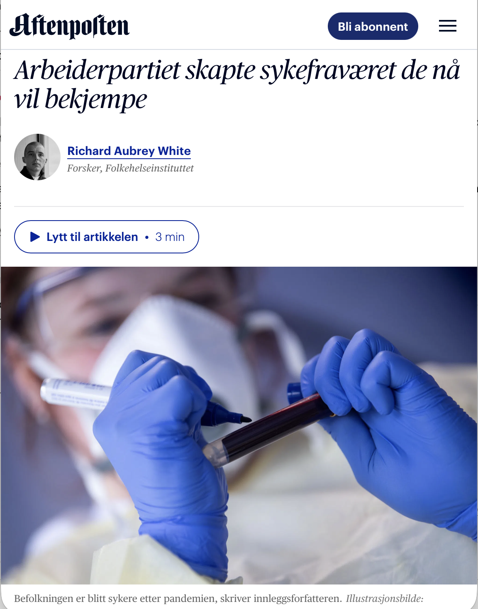

# The Labour Party created the sick leave they now want to fight

*Op-ed • Aftenposten*

Op-ed

Aftenposten

What Labour presents as a cultural problem is a measurable consequence of their own coronavirus strategy.

Author

[Richard Aubrey White](https://www.rwhite.no) [![](data:image/png;base64,iVBORw0KGgoAAAANSUhEUgAAABAAAAAQCAYAAAAf8/9hAAAAGXRFWHRTb2Z0d2FyZQBBZG9iZSBJbWFnZVJlYWR5ccllPAAAA2ZpVFh0WE1MOmNvbS5hZG9iZS54bXAAAAAAADw/eHBhY2tldCBiZWdpbj0i77u/IiBpZD0iVzVNME1wQ2VoaUh6cmVTek5UY3prYzlkIj8+IDx4OnhtcG1ldGEgeG1sbnM6eD0iYWRvYmU6bnM6bWV0YS8iIHg6eG1wdGs9IkFkb2JlIFhNUCBDb3JlIDUuMC1jMDYwIDYxLjEzNDc3NywgMjAxMC8wMi8xMi0xNzozMjowMCAgICAgICAgIj4gPHJkZjpSREYgeG1sbnM6cmRmPSJodHRwOi8vd3d3LnczLm9yZy8xOTk5LzAyLzIyLXJkZi1zeW50YXgtbnMjIj4gPHJkZjpEZXNjcmlwdGlvbiByZGY6YWJvdXQ9IiIgeG1sbnM6eG1wTU09Imh0dHA6Ly9ucy5hZG9iZS5jb20veGFwLzEuMC9tbS8iIHhtbG5zOnN0UmVmPSJodHRwOi8vbnMuYWRvYmUuY29tL3hhcC8xLjAvc1R5cGUvUmVzb3VyY2VSZWYjIiB4bWxuczp4bXA9Imh0dHA6Ly9ucy5hZG9iZS5jb20veGFwLzEuMC8iIHhtcE1NOk9yaWdpbmFsRG9jdW1lbnRJRD0ieG1wLmRpZDo1N0NEMjA4MDI1MjA2ODExOTk0QzkzNTEzRjZEQTg1NyIgeG1wTU06RG9jdW1lbnRJRD0ieG1wLmRpZDozM0NDOEJGNEZGNTcxMUUxODdBOEVCODg2RjdCQ0QwOSIgeG1wTU06SW5zdGFuY2VJRD0ieG1wLmlpZDozM0NDOEJGM0ZGNTcxMUUxODdBOEVCODg2RjdCQ0QwOSIgeG1wOkNyZWF0b3JUb29sPSJBZG9iZSBQaG90b3Nob3AgQ1M1IE1hY2ludG9zaCI+IDx4bXBNTTpEZXJpdmVkRnJvbSBzdFJlZjppbnN0YW5jZUlEPSJ4bXAuaWlkOkZDN0YxMTc0MDcyMDY4MTE5NUZFRDc5MUM2MUUwNEREIiBzdFJlZjpkb2N1bWVudElEPSJ4bXAuZGlkOjU3Q0QyMDgwMjUyMDY4MTE5OTRDOTM1MTNGNkRBODU3Ii8+IDwvcmRmOkRlc2NyaXB0aW9uPiA8L3JkZjpSREY+IDwveDp4bXBtZXRhPiA8P3hwYWNrZXQgZW5kPSJyIj8+84NovQAAAR1JREFUeNpiZEADy85ZJgCpeCB2QJM6AMQLo4yOL0AWZETSqACk1gOxAQN+cAGIA4EGPQBxmJA0nwdpjjQ8xqArmczw5tMHXAaALDgP1QMxAGqzAAPxQACqh4ER6uf5MBlkm0X4EGayMfMw/Pr7Bd2gRBZogMFBrv01hisv5jLsv9nLAPIOMnjy8RDDyYctyAbFM2EJbRQw+aAWw/LzVgx7b+cwCHKqMhjJFCBLOzAR6+lXX84xnHjYyqAo5IUizkRCwIENQQckGSDGY4TVgAPEaraQr2a4/24bSuoExcJCfAEJihXkWDj3ZAKy9EJGaEo8T0QSxkjSwORsCAuDQCD+QILmD1A9kECEZgxDaEZhICIzGcIyEyOl2RkgwAAhkmC+eAm0TAAAAABJRU5ErkJggg==)](https://orcid.org/0000-0002-6747-1726)

Published

April 27, 2026

*This is a translation of the original Norwegian op-ed, and discrepancies may exist.*

Published in [Aftenposten on April 27, 2026](https://www.aftenposten.no/meninger/debatt/i/JOnbx4/richard-aubrey-white-ap-skylder-nordmenn-en-helsestrategi-og-huske-pandemien).

Minister of Labour Kjersti Stenseng and Minister of Health Jan Christian Vestre, both from the Labour Party, believe it has become too easy to get a sick note. Stenseng reminds us that “life is rough sometimes.” But what they present as a cultural problem is a measurable consequence of their own coronavirus strategy.

Since 2022, Norway has based its coronavirus strategy on the population maintaining immunity through repeated reinfections. The Norwegian Institute of Public Health has itself documented a 6 percent risk of long COVID after a first infection, and the risk does not decrease with reinfection.

With a population reinfected repeatedly, we must expect that several hundred thousand Norwegians are affected. Yet long COVID is not mentioned in the policy documents. We do not test the population, and there is not even a diagnostic code for long COVID.

In three peer-reviewed studies, I have documented the consequences. GP consultations and sick leave have increased. They are driven by diagnoses that are known symptoms of long COVID. The increases follow the coronavirus waves. And we have had 11,500 more deaths than expected since the coronavirus strategy was introduced.

Nor is this a uniquely Norwegian phenomenon. In 2024, sick leave in Europe is still at the level of 2020 – the first year of the pandemic. Ignoring the coronavirus has not spared us the consequences. We top the European sick-leave statistics not because Norwegians have become lazy, but because the system lets people take the sick leave they need – in a population that is measurably sicker than before the pandemic.

How a patient is coded depends on what the GP knows. A patient who has tested positive for COVID-19 may be given fatigue (A04) as a diagnosis. The same patient without a test – because no one tests anymore – typically ends up under “burnout” or other “milder psychological complaints.” That is precisely the category Stenseng now believes people should be able to work through.

When COVID-19 is barely mentioned anymore, it is likely that many of the “burned out” actually have long COVID – without either they or their doctor knowing it.

Sick leave is not falling, because the population is measurably sicker and because the government has chosen a strategy that contributes to that sickness.

If Labour really wants a healthier population, they must first acknowledge that the coronavirus is airborne. The measures that actually work – ventilation, filtration and indoor air quality – are heavily underinvested. In 2023, ASHRAE, the international professional organization for heating, ventilation, air conditioning, refrigeration and the built environment, published Standard 241 for air changes and filtration during periods of infection risk. Norway has nothing equivalent and still builds to a standard written before the coronavirus existed.

We need our own ASHRAE 241, starting in schools and healthcare institutions. In addition, the government must recognize long COVID in policy documents, introduce a diagnostic code, reinstate testing recommendations, and ensure up-to-date vaccines for everyone who wants them.

It is not the GPs or the patients who must hold the line. It is the cabinet ministers who must stop passing the bill for their own policy on to those who are already paying with their health.

*Richard Aubrey White is a senior researcher at the Norwegian Institute of Public Health, but does not write on behalf of his employer.*
