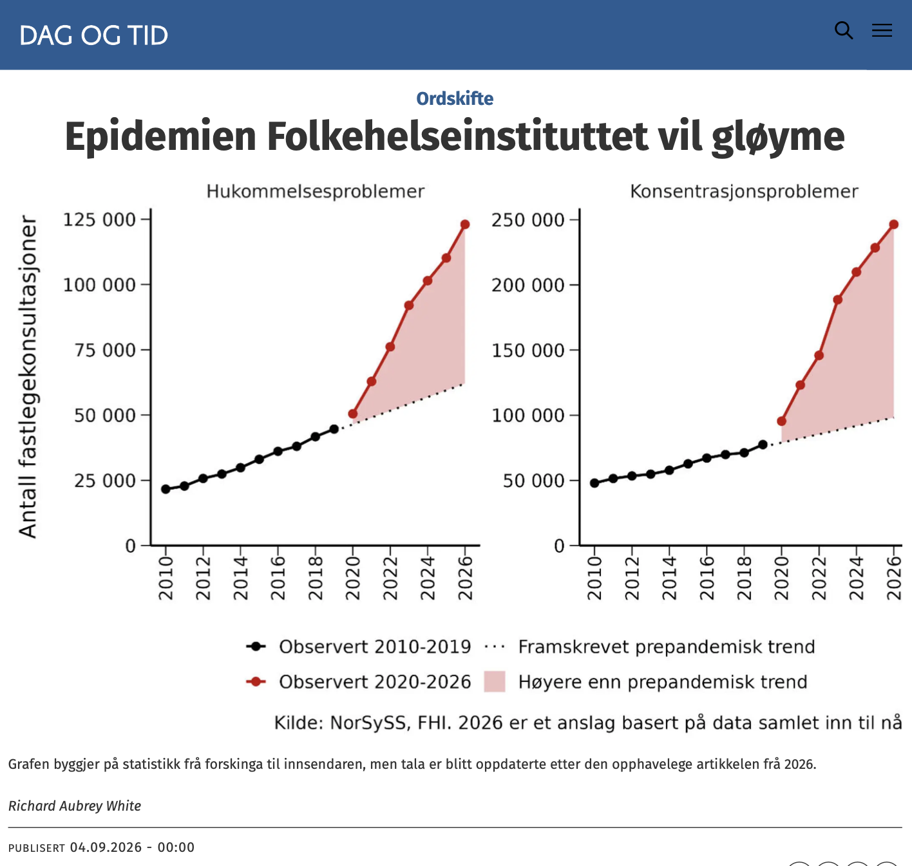

# Epidemien Folkehelseinstituttet vil gløyme

*Op-ed • Dag og Tid*

Op-ed

Dag og Tid

FHI avviser advarslene om varige skader etter gjentatt koronasmitte. FHIs egne overvåkingsdata peker i motsatt retning.

Author

[Richard Aubrey White](https://www.rwhite.no) [![](data:image/png;base64,iVBORw0KGgoAAAANSUhEUgAAABAAAAAQCAYAAAAf8/9hAAAAGXRFWHRTb2Z0d2FyZQBBZG9iZSBJbWFnZVJlYWR5ccllPAAAA2ZpVFh0WE1MOmNvbS5hZG9iZS54bXAAAAAAADw/eHBhY2tldCBiZWdpbj0i77u/IiBpZD0iVzVNME1wQ2VoaUh6cmVTek5UY3prYzlkIj8+IDx4OnhtcG1ldGEgeG1sbnM6eD0iYWRvYmU6bnM6bWV0YS8iIHg6eG1wdGs9IkFkb2JlIFhNUCBDb3JlIDUuMC1jMDYwIDYxLjEzNDc3NywgMjAxMC8wMi8xMi0xNzozMjowMCAgICAgICAgIj4gPHJkZjpSREYgeG1sbnM6cmRmPSJodHRwOi8vd3d3LnczLm9yZy8xOTk5LzAyLzIyLXJkZi1zeW50YXgtbnMjIj4gPHJkZjpEZXNjcmlwdGlvbiByZGY6YWJvdXQ9IiIgeG1sbnM6eG1wTU09Imh0dHA6Ly9ucy5hZG9iZS5jb20veGFwLzEuMC9tbS8iIHhtbG5zOnN0UmVmPSJodHRwOi8vbnMuYWRvYmUuY29tL3hhcC8xLjAvc1R5cGUvUmVzb3VyY2VSZWYjIiB4bWxuczp4bXA9Imh0dHA6Ly9ucy5hZG9iZS5jb20veGFwLzEuMC8iIHhtcE1NOk9yaWdpbmFsRG9jdW1lbnRJRD0ieG1wLmRpZDo1N0NEMjA4MDI1MjA2ODExOTk0QzkzNTEzRjZEQTg1NyIgeG1wTU06RG9jdW1lbnRJRD0ieG1wLmRpZDozM0NDOEJGNEZGNTcxMUUxODdBOEVCODg2RjdCQ0QwOSIgeG1wTU06SW5zdGFuY2VJRD0ieG1wLmlpZDozM0NDOEJGM0ZGNTcxMUUxODdBOEVCODg2RjdCQ0QwOSIgeG1wOkNyZWF0b3JUb29sPSJBZG9iZSBQaG90b3Nob3AgQ1M1IE1hY2ludG9zaCI+IDx4bXBNTTpEZXJpdmVkRnJvbSBzdFJlZjppbnN0YW5jZUlEPSJ4bXAuaWlkOkZDN0YxMTc0MDcyMDY4MTE5NUZFRDc5MUM2MUUwNEREIiBzdFJlZjpkb2N1bWVudElEPSJ4bXAuZGlkOjU3Q0QyMDgwMjUyMDY4MTE5OTRDOTM1MTNGNkRBODU3Ii8+IDwvcmRmOkRlc2NyaXB0aW9uPiA8L3JkZjpSREY+IDwveDp4bXBtZXRhPiA8P3hwYWNrZXQgZW5kPSJyIj8+84NovQAAAR1JREFUeNpiZEADy85ZJgCpeCB2QJM6AMQLo4yOL0AWZETSqACk1gOxAQN+cAGIA4EGPQBxmJA0nwdpjjQ8xqArmczw5tMHXAaALDgP1QMxAGqzAAPxQACqh4ER6uf5MBlkm0X4EGayMfMw/Pr7Bd2gRBZogMFBrv01hisv5jLsv9nLAPIOMnjy8RDDyYctyAbFM2EJbRQw+aAWw/LzVgx7b+cwCHKqMhjJFCBLOzAR6+lXX84xnHjYyqAo5IUizkRCwIENQQckGSDGY4TVgAPEaraQr2a4/24bSuoExcJCfAEJihXkWDj3ZAKy9EJGaEo8T0QSxkjSwORsCAuDQCD+QILmD1A9kECEZgxDaEZhICIzGcIyEyOl2RkgwAAhkmC+eAm0TAAAAABJRU5ErkJggg==)](https://orcid.org/0000-0002-6747-1726)

Published

September 4, 2026

Publisert i [Dag og Tid den 4. september 2026](https://www.dagogtid.no/ordskifte/epidemien-folkehelseinstituttet-vil-gloyme/693193).

Da Dag og Tid ba Folkehelseinstituttet (FHI) om instituttets syn på uttalelsene til Yale-professor Akiko Iwasaki om koronaviruset, avfeide fagdirektør og tidligere fungerende smitteverndirektør Preben Aavitsland dem som «ville spekulasjonar», kanskje nyttige «for å vere relevante og få forskingspengar». I en senere e-post skrev han at advarslene fra professor Al-Aly om varig skade etter gjentatt koronasmitte «syner seg gong på gong ikkje å stemme». Var de sanne, ville vi nå ha sett en «epidemi av nevrologiske eller psykiatriske sjukdomar, hjartesjukdomar, kreft eller nyresjukdomar». Det har vi ikke, hevder han.

La oss teste denne påstanden med data som FHI sitter på.

Ta den nevrologiske og psykiatriske bølgen han hevder ikke finnes. I FHIs syndromovervåkingssystem ligger vi an til å ha 98 prosent flere fastlegekonsultasjoner for hukommelsesproblemer i år enn det man hadde forventet før pandemien. For konsentrasjonsproblemer er det samme tallet 150 prosent høyere (basert på tallene så langt i år). Disse diagnosekodene pleier å øke etter koronabølger.

Ta økningen i hjertesykdommer han sier ikke eksisterer. Mot førpandemiske trender lå antallet brukere av hjerte- og karmedisiner i 2024 rundt 7 prosent over hva som var forventet i Norge, 10 prosent over i Danmark og 7 prosent over i Sverige. For blodtrykksmedisiner alene var de samme tallene 23, 58 og 38 prosent over. Tre land, samme retning, hundretusener flere enn ventet.

En fersk Universitetet i Oslo-studie av nesten 20.000 trøndere fant at koronasmittede hadde høyere troponinnivåer enn andre – en markør for hjertebelastning. Slike studier forklarer biologisk hvorfor flere begynner på hjertemedisin.

I 2025 slo European Society of Cardiology fast at koronainfeksjoner har «alvorlige effekter på hjertet og blodårene», med varig påvirkning på folkehelsen. Det som er viden akseptert i utlandet, benektes her hjemme.

Jeg er åpen for andre forklaringer. Men de må forklare hele bildet – alle økningene, i alle landene – og jeg tviler på at noen samlet forklaring kan utelate korona fullstendig. At landets fremste smittevernmyndighet heller angriper budbringeren enn å se på egne tall, burde bekymre alle som bryr seg om folkehelsa.

Mot alt dette forsvarer Aavitsland standpunktet sitt på sosiale medier ved å vise til én dansk studie som finner at korona beskytter mot hjerteinfarkt (innlegget inkluderer også Aavitslands tradisjonelle personangrep på kolleger ved Oslo universitetssykehus). Det er plausibelt at korona skader hjerte og kar, eller ikke har en effekt. Det er ikke plausibelt at korona beskytter hjertet. Når en studie finner at korona er «beskyttende», er det et tegn på alvorlige skjevheter i studien. Den samme danske gruppen har også publisert en studie som finner at korona beskytter mot autisme.

Hvorfor ignorerer FHIs fagdirektør for overvåking FHIs egne overvåkingsdata? Kanskje har han ikke sett godt nok etter – eller kanskje er han ikke interessert i å se etter. Aavitsland har brukt en årrekke på å bagatellisere konsekvensene av koronainfeksjoner. Dersom han tar feil, har han deler av ansvaret for at nordmenn har blitt sykere, og at flere enn nødvendig lider av longcovid. Er ikke det en interessekonflikt, så vet ikke jeg.

*Richard Aubrey White har doktorgrad i biostatistikk frå Harvard University. Han er forskar ved Folkehelseinstituttet (FHI), men uttalar seg ikkje på vegner av instituttet.*
