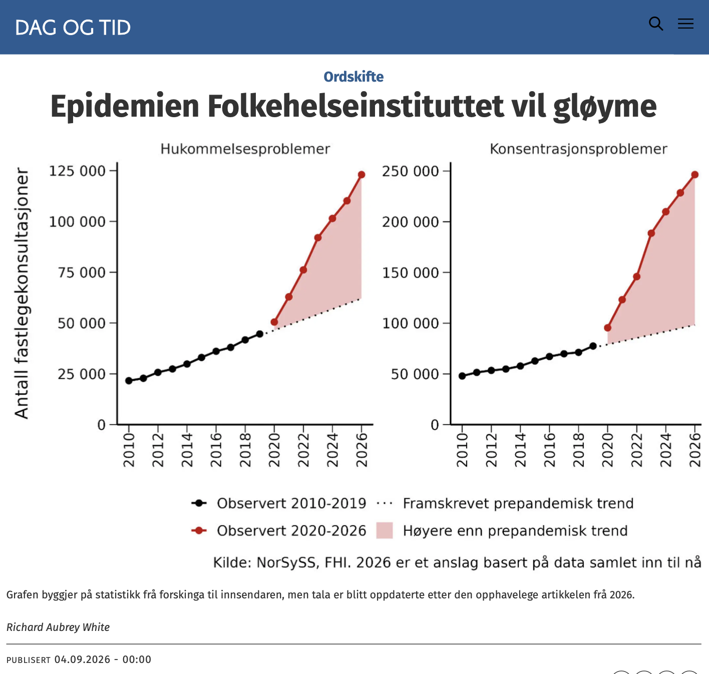

# The epidemic the Institute of Public Health wants to forget

*Op-ed • Dag og Tid*

Op-ed

Dag og Tid

The Norwegian Institute of Public Health dismisses the warnings about lasting damage from repeated coronavirus infection. Its own surveillance data point the other way.

Author

[Richard Aubrey White](https://www.rwhite.no) [![](data:image/png;base64,iVBORw0KGgoAAAANSUhEUgAAABAAAAAQCAYAAAAf8/9hAAAAGXRFWHRTb2Z0d2FyZQBBZG9iZSBJbWFnZVJlYWR5ccllPAAAA2ZpVFh0WE1MOmNvbS5hZG9iZS54bXAAAAAAADw/eHBhY2tldCBiZWdpbj0i77u/IiBpZD0iVzVNME1wQ2VoaUh6cmVTek5UY3prYzlkIj8+IDx4OnhtcG1ldGEgeG1sbnM6eD0iYWRvYmU6bnM6bWV0YS8iIHg6eG1wdGs9IkFkb2JlIFhNUCBDb3JlIDUuMC1jMDYwIDYxLjEzNDc3NywgMjAxMC8wMi8xMi0xNzozMjowMCAgICAgICAgIj4gPHJkZjpSREYgeG1sbnM6cmRmPSJodHRwOi8vd3d3LnczLm9yZy8xOTk5LzAyLzIyLXJkZi1zeW50YXgtbnMjIj4gPHJkZjpEZXNjcmlwdGlvbiByZGY6YWJvdXQ9IiIgeG1sbnM6eG1wTU09Imh0dHA6Ly9ucy5hZG9iZS5jb20veGFwLzEuMC9tbS8iIHhtbG5zOnN0UmVmPSJodHRwOi8vbnMuYWRvYmUuY29tL3hhcC8xLjAvc1R5cGUvUmVzb3VyY2VSZWYjIiB4bWxuczp4bXA9Imh0dHA6Ly9ucy5hZG9iZS5jb20veGFwLzEuMC8iIHhtcE1NOk9yaWdpbmFsRG9jdW1lbnRJRD0ieG1wLmRpZDo1N0NEMjA4MDI1MjA2ODExOTk0QzkzNTEzRjZEQTg1NyIgeG1wTU06RG9jdW1lbnRJRD0ieG1wLmRpZDozM0NDOEJGNEZGNTcxMUUxODdBOEVCODg2RjdCQ0QwOSIgeG1wTU06SW5zdGFuY2VJRD0ieG1wLmlpZDozM0NDOEJGM0ZGNTcxMUUxODdBOEVCODg2RjdCQ0QwOSIgeG1wOkNyZWF0b3JUb29sPSJBZG9iZSBQaG90b3Nob3AgQ1M1IE1hY2ludG9zaCI+IDx4bXBNTTpEZXJpdmVkRnJvbSBzdFJlZjppbnN0YW5jZUlEPSJ4bXAuaWlkOkZDN0YxMTc0MDcyMDY4MTE5NUZFRDc5MUM2MUUwNEREIiBzdFJlZjpkb2N1bWVudElEPSJ4bXAuZGlkOjU3Q0QyMDgwMjUyMDY4MTE5OTRDOTM1MTNGNkRBODU3Ii8+IDwvcmRmOkRlc2NyaXB0aW9uPiA8L3JkZjpSREY+IDwveDp4bXBtZXRhPiA8P3hwYWNrZXQgZW5kPSJyIj8+84NovQAAAR1JREFUeNpiZEADy85ZJgCpeCB2QJM6AMQLo4yOL0AWZETSqACk1gOxAQN+cAGIA4EGPQBxmJA0nwdpjjQ8xqArmczw5tMHXAaALDgP1QMxAGqzAAPxQACqh4ER6uf5MBlkm0X4EGayMfMw/Pr7Bd2gRBZogMFBrv01hisv5jLsv9nLAPIOMnjy8RDDyYctyAbFM2EJbRQw+aAWw/LzVgx7b+cwCHKqMhjJFCBLOzAR6+lXX84xnHjYyqAo5IUizkRCwIENQQckGSDGY4TVgAPEaraQr2a4/24bSuoExcJCfAEJihXkWDj3ZAKy9EJGaEo8T0QSxkjSwORsCAuDQCD+QILmD1A9kECEZgxDaEZhICIzGcIyEyOl2RkgwAAhkmC+eAm0TAAAAABJRU5ErkJggg==)](https://orcid.org/0000-0002-6747-1726)

Published

September 4, 2026

*This is a translation of the original Norwegian op-ed, and discrepancies may exist.*

Published in [Dag og Tid on September 4, 2026](https://www.dagogtid.no/ordskifte/epidemien-folkehelseinstituttet-vil-gloyme/693193).

When Dag og Tid asked the Norwegian Institute of Public Health (FHI) for the institute’s view on Yale professor Akiko Iwasaki’s statements about the coronavirus, scientific director and former acting director of infection control Preben Aavitsland dismissed them as “wild speculation,” perhaps useful “for staying relevant and getting research funding.” In a later email he wrote that the warnings from professor Al-Aly about lasting damage after repeated coronavirus infection “turn out again and again not to hold.” If they were true, we would by now have seen an “epidemic of neurological or psychiatric diseases, heart disease, cancer or kidney disease.” We have not, he claims.

Let us test that claim with data FHI holds.

Take the neurological and psychiatric wave he says does not exist. In FHI’s syndromic surveillance system, we are on track for 98 percent more GP consultations for memory problems this year than would have been expected before the pandemic. For concentration problems the same figure is 150 percent higher (based on the numbers so far this year). These diagnostic codes tend to rise after coronavirus waves.

Take the increase in heart disease he says does not exist. Against pre-pandemic trends, the number of people using cardiovascular medicines in 2024 was about 7 percent above what was expected in Norway, 10 percent above in Denmark and 7 percent above in Sweden. For blood pressure medicines alone the same figures were 23, 58 and 38 percent above. Three countries, the same direction, hundreds of thousands more than expected.

A recent University of Oslo study of nearly 20,000 people in Trøndelag found that those infected with the coronavirus had higher troponin levels than others, a marker of cardiac strain. Studies like this explain biologically why more people start on heart medication.

In 2025 the European Society of Cardiology concluded that coronavirus infections have “serious effects on the heart and blood vessels,” with lasting consequences for public health. What is widely accepted abroad is denied here at home.

I am open to other explanations. But they must explain the whole picture, all the increases, in all the countries, and I doubt that any single explanation can leave the coronavirus out entirely. That the country’s foremost infection control authority attacks the messenger rather than looking at its own numbers should worry everyone who cares about public health.

Against all of this, Aavitsland defends his position on social media by pointing to one Danish study finding that the coronavirus protects against heart attack (the post also includes Aavitsland’s traditional personal attacks on colleagues at Oslo University Hospital). It is plausible that the coronavirus damages the heart and blood vessels, or that it has no effect. It is not plausible that the coronavirus protects the heart. When a study finds that the coronavirus is “protective,” that is a sign of serious bias in the study. The same Danish group has also published a study finding that the coronavirus protects against autism.

Why does FHI’s scientific director for surveillance ignore FHI’s own surveillance data? Perhaps he has not looked carefully enough, or perhaps he is not interested in looking. Aavitsland has spent years playing down the consequences of coronavirus infections. If he is wrong, he carries part of the responsibility for Norwegians becoming sicker, and for more people than necessary living with long COVID. If that is not a conflict of interest, I do not know what is.

*Richard Aubrey White has a PhD in biostatistics from Harvard University. He is a researcher at the Norwegian Institute of Public Health (FHI), but does not speak on behalf of the institute.*
