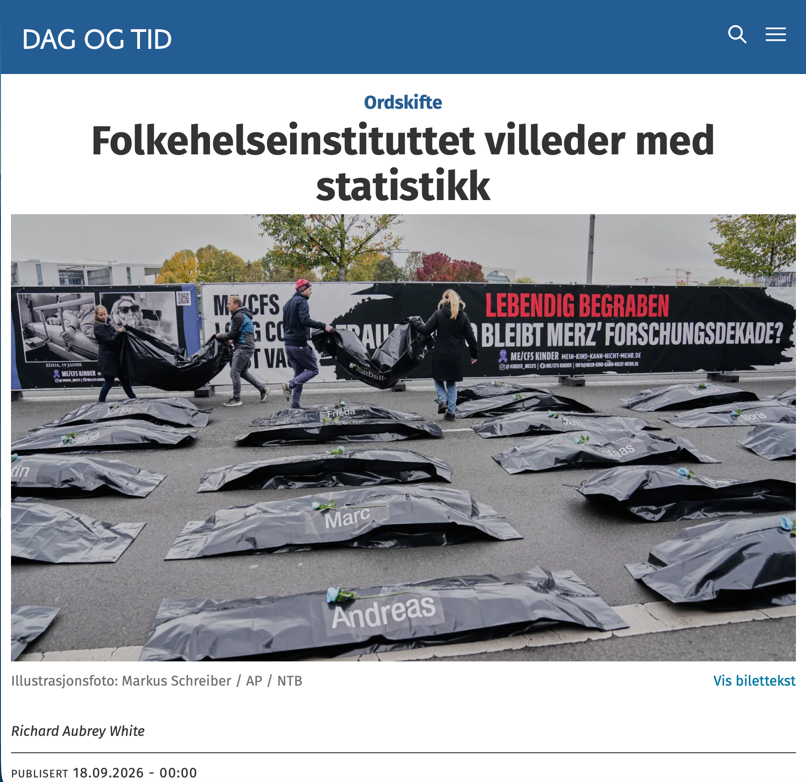

# Folkehelseinstituttet villeder med statistikk

*Op-ed • Dag og Tid*

Op-ed

Dag og Tid

FHIs fagdirektør svarte med å bytte målestokk. Forventet levealder har nesten sluttet å øke, og nedgangen i hjerte- og kardødeligheten har nesten stoppet opp.

Author

[Richard Aubrey White](https://www.rwhite.no) [![](data:image/png;base64,iVBORw0KGgoAAAANSUhEUgAAABAAAAAQCAYAAAAf8/9hAAAAGXRFWHRTb2Z0d2FyZQBBZG9iZSBJbWFnZVJlYWR5ccllPAAAA2ZpVFh0WE1MOmNvbS5hZG9iZS54bXAAAAAAADw/eHBhY2tldCBiZWdpbj0i77u/IiBpZD0iVzVNME1wQ2VoaUh6cmVTek5UY3prYzlkIj8+IDx4OnhtcG1ldGEgeG1sbnM6eD0iYWRvYmU6bnM6bWV0YS8iIHg6eG1wdGs9IkFkb2JlIFhNUCBDb3JlIDUuMC1jMDYwIDYxLjEzNDc3NywgMjAxMC8wMi8xMi0xNzozMjowMCAgICAgICAgIj4gPHJkZjpSREYgeG1sbnM6cmRmPSJodHRwOi8vd3d3LnczLm9yZy8xOTk5LzAyLzIyLXJkZi1zeW50YXgtbnMjIj4gPHJkZjpEZXNjcmlwdGlvbiByZGY6YWJvdXQ9IiIgeG1sbnM6eG1wTU09Imh0dHA6Ly9ucy5hZG9iZS5jb20veGFwLzEuMC9tbS8iIHhtbG5zOnN0UmVmPSJodHRwOi8vbnMuYWRvYmUuY29tL3hhcC8xLjAvc1R5cGUvUmVzb3VyY2VSZWYjIiB4bWxuczp4bXA9Imh0dHA6Ly9ucy5hZG9iZS5jb20veGFwLzEuMC8iIHhtcE1NOk9yaWdpbmFsRG9jdW1lbnRJRD0ieG1wLmRpZDo1N0NEMjA4MDI1MjA2ODExOTk0QzkzNTEzRjZEQTg1NyIgeG1wTU06RG9jdW1lbnRJRD0ieG1wLmRpZDozM0NDOEJGNEZGNTcxMUUxODdBOEVCODg2RjdCQ0QwOSIgeG1wTU06SW5zdGFuY2VJRD0ieG1wLmlpZDozM0NDOEJGM0ZGNTcxMUUxODdBOEVCODg2RjdCQ0QwOSIgeG1wOkNyZWF0b3JUb29sPSJBZG9iZSBQaG90b3Nob3AgQ1M1IE1hY2ludG9zaCI+IDx4bXBNTTpEZXJpdmVkRnJvbSBzdFJlZjppbnN0YW5jZUlEPSJ4bXAuaWlkOkZDN0YxMTc0MDcyMDY4MTE5NUZFRDc5MUM2MUUwNEREIiBzdFJlZjpkb2N1bWVudElEPSJ4bXAuZGlkOjU3Q0QyMDgwMjUyMDY4MTE5OTRDOTM1MTNGNkRBODU3Ii8+IDwvcmRmOkRlc2NyaXB0aW9uPiA8L3JkZjpSREY+IDwveDp4bXBtZXRhPiA8P3hwYWNrZXQgZW5kPSJyIj8+84NovQAAAR1JREFUeNpiZEADy85ZJgCpeCB2QJM6AMQLo4yOL0AWZETSqACk1gOxAQN+cAGIA4EGPQBxmJA0nwdpjjQ8xqArmczw5tMHXAaALDgP1QMxAGqzAAPxQACqh4ER6uf5MBlkm0X4EGayMfMw/Pr7Bd2gRBZogMFBrv01hisv5jLsv9nLAPIOMnjy8RDDyYctyAbFM2EJbRQw+aAWw/LzVgx7b+cwCHKqMhjJFCBLOzAR6+lXX84xnHjYyqAo5IUizkRCwIENQQckGSDGY4TVgAPEaraQr2a4/24bSuoExcJCfAEJihXkWDj3ZAKy9EJGaEo8T0QSxkjSwORsCAuDQCD+QILmD1A9kECEZgxDaEZhICIzGcIyEyOl2RkgwAAhkmC+eAm0TAAAAABJRU5ErkJggg==)](https://orcid.org/0000-0002-6747-1726)

Published

September 18, 2026

Publisert i [Dag og Tid den 18. september 2026](https://www.dagogtid.no/ordskifte/folkehelseinstituttet-villeder-med-statistikk/694990).

Folkehelseinstituttets (FHI) fagdirektør Preben Aavitsland mente at forskningen som viser at covid-19 gir varige helseskader, [ikke holder](https://www.dagogtid.no/pa-vent/meiner-at-iwasaki-er-uansvarleg/678209). Da ville vi sett det i overvåkingsdataene, og det gjør vi ikke, mente han. Jeg svarte [4. september](https://www.dagogtid.no/ordskifte/epidemien-folkehelseinstituttet-vil-gloyme/693193) at FHIs data viser store økninger. I svaret ([11. september](https://www.dagogtid.no/ordskifte/folkehelsa-i-noreg-etter-pandemien/694233)) gjør han to ting: bytter målestokk, og hevder at økningene jeg pekte på skyldes noe annet enn covid-19.

Først bruker Aavitsland tre ulike målestokker: Hjerteinfarkt viser «ein fin nedgang», hjerneslag er «stabilt», og psykiske lidelser (som øker) følger «trendane frå før pandemien». Forskere stiller bare ett spørsmål: Er tallene høyere, lavere eller som forventet, gitt trenden før pandemien? At en kurve fortsatt peker nedover, sier ingenting om den går ned like raskt som før. Trender som endrer seg er et varsel som bør følges opp.

Forventet levealder oppsummerer folkehelsen. Fra 2010 til 2019 økte den med 0,22 år årlig. Fra 2020 til 2025 økte den med 0,02 år årlig. Fremgangen har nesten stoppet opp.

Aavitsland avfeide de store økningene i hjertemedisinbruk. La oss prøve en annen indikator, da. Fra 2010 til 2019 sank dødeligheten av hjerte- og karsykdom, justert for alder, med 13 dødsfall per 100 000 årlig. Fra 2020 til 2025 sank den kun med 3 årlig. Hadde nedgangen fortsatt, ville 3000 færre nordmenn ha dødd av det i 2025.

Så «noe annet». Konsultasjoner for hukommelses- og konsentrasjonsproblemer, 98 og 150 prosent over forventet, skyldes ifølge Aavitsland endret atferd hos pasientene og fastlegene. Men [FHIs egen studie](https://www.sciencedirect.com/science/article/pii/S0264410X2401346X?via%3Dihub) (uavhengig av fastlegene) fant at 7 prosent av dobbeltvaksinerte fikk hukommelsesproblemer etter omikron, og 6 prosent konsentrasjonsproblemer. Aavitsland kaller dem «heldigvis få». Hvor mange hundre tusen nordmenn er 6 prosent?

Aavitslands opprinnelige grunn til å avvise forskningen var at alt så bra ut i overvåkingsdataene. Nå har han byttet grunn og sier at forverrede trender ikke betyr forverret helse. Konklusjonen virker bestemt på forhånd.

*Richard Aubrey White har doktorgrad i biostatistikk frå Harvard University. Han er forskar ved Folkehelseinstituttet (FHI), men uttalar seg ikkje på vegner av instituttet.*
