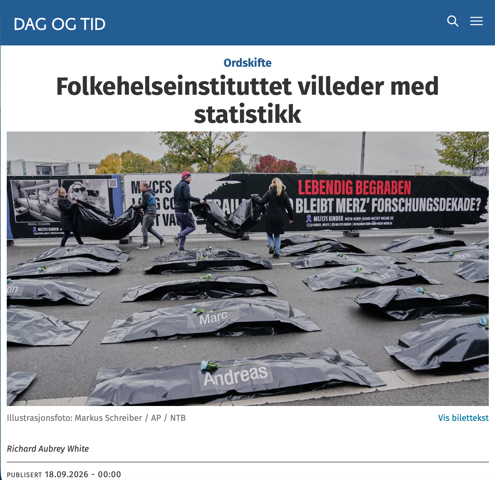

# The Norwegian Institute of Public Health misleads with statistics

*Op-ed • Dag og Tid*

Op-ed

Dag og Tid

FHI’s scientific director replied by switching yardstick. Life expectancy has almost stopped rising, and the fall in cardiovascular mortality has almost stopped.

Author

[Richard Aubrey White](https://www.rwhite.no) [![](data:image/png;base64,iVBORw0KGgoAAAANSUhEUgAAABAAAAAQCAYAAAAf8/9hAAAAGXRFWHRTb2Z0d2FyZQBBZG9iZSBJbWFnZVJlYWR5ccllPAAAA2ZpVFh0WE1MOmNvbS5hZG9iZS54bXAAAAAAADw/eHBhY2tldCBiZWdpbj0i77u/IiBpZD0iVzVNME1wQ2VoaUh6cmVTek5UY3prYzlkIj8+IDx4OnhtcG1ldGEgeG1sbnM6eD0iYWRvYmU6bnM6bWV0YS8iIHg6eG1wdGs9IkFkb2JlIFhNUCBDb3JlIDUuMC1jMDYwIDYxLjEzNDc3NywgMjAxMC8wMi8xMi0xNzozMjowMCAgICAgICAgIj4gPHJkZjpSREYgeG1sbnM6cmRmPSJodHRwOi8vd3d3LnczLm9yZy8xOTk5LzAyLzIyLXJkZi1zeW50YXgtbnMjIj4gPHJkZjpEZXNjcmlwdGlvbiByZGY6YWJvdXQ9IiIgeG1sbnM6eG1wTU09Imh0dHA6Ly9ucy5hZG9iZS5jb20veGFwLzEuMC9tbS8iIHhtbG5zOnN0UmVmPSJodHRwOi8vbnMuYWRvYmUuY29tL3hhcC8xLjAvc1R5cGUvUmVzb3VyY2VSZWYjIiB4bWxuczp4bXA9Imh0dHA6Ly9ucy5hZG9iZS5jb20veGFwLzEuMC8iIHhtcE1NOk9yaWdpbmFsRG9jdW1lbnRJRD0ieG1wLmRpZDo1N0NEMjA4MDI1MjA2ODExOTk0QzkzNTEzRjZEQTg1NyIgeG1wTU06RG9jdW1lbnRJRD0ieG1wLmRpZDozM0NDOEJGNEZGNTcxMUUxODdBOEVCODg2RjdCQ0QwOSIgeG1wTU06SW5zdGFuY2VJRD0ieG1wLmlpZDozM0NDOEJGM0ZGNTcxMUUxODdBOEVCODg2RjdCQ0QwOSIgeG1wOkNyZWF0b3JUb29sPSJBZG9iZSBQaG90b3Nob3AgQ1M1IE1hY2ludG9zaCI+IDx4bXBNTTpEZXJpdmVkRnJvbSBzdFJlZjppbnN0YW5jZUlEPSJ4bXAuaWlkOkZDN0YxMTc0MDcyMDY4MTE5NUZFRDc5MUM2MUUwNEREIiBzdFJlZjpkb2N1bWVudElEPSJ4bXAuZGlkOjU3Q0QyMDgwMjUyMDY4MTE5OTRDOTM1MTNGNkRBODU3Ii8+IDwvcmRmOkRlc2NyaXB0aW9uPiA8L3JkZjpSREY+IDwveDp4bXBtZXRhPiA8P3hwYWNrZXQgZW5kPSJyIj8+84NovQAAAR1JREFUeNpiZEADy85ZJgCpeCB2QJM6AMQLo4yOL0AWZETSqACk1gOxAQN+cAGIA4EGPQBxmJA0nwdpjjQ8xqArmczw5tMHXAaALDgP1QMxAGqzAAPxQACqh4ER6uf5MBlkm0X4EGayMfMw/Pr7Bd2gRBZogMFBrv01hisv5jLsv9nLAPIOMnjy8RDDyYctyAbFM2EJbRQw+aAWw/LzVgx7b+cwCHKqMhjJFCBLOzAR6+lXX84xnHjYyqAo5IUizkRCwIENQQckGSDGY4TVgAPEaraQr2a4/24bSuoExcJCfAEJihXkWDj3ZAKy9EJGaEo8T0QSxkjSwORsCAuDQCD+QILmD1A9kECEZgxDaEZhICIzGcIyEyOl2RkgwAAhkmC+eAm0TAAAAABJRU5ErkJggg==)](https://orcid.org/0000-0002-6747-1726)

Published

September 18, 2026

*This is a translation of the original Norwegian op-ed, and discrepancies may exist.*

Published in [Dag og Tid on September 18, 2026](https://www.dagogtid.no/ordskifte/folkehelseinstituttet-villeder-med-statistikk/694990).

Preben Aavitsland, scientific director at the Norwegian Institute of Public Health (FHI), argued that the research showing that covid-19 causes lasting health damage [does not hold up](https://www.dagogtid.no/pa-vent/meiner-at-iwasaki-er-uansvarleg/678209). If it did, we would see it in the surveillance data, and we do not, he said. I replied on [September 4](https://www.dagogtid.no/ordskifte/epidemien-folkehelseinstituttet-vil-gloyme/693193) that FHI’s data show large increases. In his reply ([September 11](https://www.dagogtid.no/ordskifte/folkehelsa-i-noreg-etter-pandemien/694233)) he does two things: he switches yardstick, and he claims that the increases I pointed to are caused by something other than covid-19.

First, Aavitsland uses three different yardsticks: heart attacks show “a fine decline,” stroke is “stable,” and mental disorders (which are rising) follow “the trends from before the pandemic.” Researchers ask only one question: are the numbers higher, lower or as expected, given the trend before the pandemic? That a curve still points downwards says nothing about whether it falls as fast as it used to. Trends that change are a warning that should be followed up.

Life expectancy sums up public health. From 2010 to 2019 it rose by 0.22 years per year. From 2020 to 2025 it rose by 0.02 years per year. The progress has almost stopped.

Aavitsland dismissed the large increases in the use of heart medication. So let us try another indicator. From 2010 to 2019, age-adjusted mortality from cardiovascular disease fell by 13 deaths per 100,000 per year. From 2020 to 2025 it fell by only 3 per year. Had the decline continued, 3000 fewer Norwegians would have died of it in 2025.

Then “something else.” Consultations for memory and concentration problems, 98 and 150 percent above expected, are according to Aavitsland caused by changed behaviour among patients and GPs. But [FHI’s own study](https://www.sciencedirect.com/science/article/pii/S0264410X2401346X?via%3Dihub) (independent of the GPs) found that 7 percent of people with two vaccine doses had memory problems after Omicron, and 6 percent had concentration problems. Aavitsland calls them “fortunately few.” How many hundred thousand Norwegians are 6 percent?

Aavitsland’s original reason for dismissing the research was that everything looked fine in the surveillance data. Now he has switched reason and says that worsening trends do not mean worsening health. The conclusion looks decided in advance.

*Richard Aubrey White has a PhD in biostatistics from Harvard University. He is a researcher at the Norwegian Institute of Public Health (FHI), but does not speak on behalf of the institute.*
